# Инструкция пользователя: Оборудование, Дозиметрия, Журнал и тренды

Пошаговое описание ежедневной работы с калькулятором «Клиническая дозиметрия»: как один раз завести оборудование отделения, как измерить и записать калибровку или проверку выхода пучка и как смотреть тренды и контрольные карты. Формулы, коэффициенты и ссылки на разделы протоколов — в технических описаниях: [photons.md](photons.md), [electrons.md](electrons.md), [cobalt.md](cobalt.md), [kv.md](kv.md), [journal.md](journal.md).

Все снимки экрана сделаны в версии 0.49.2 на **вымышленных данных**: «Условный онкодиспансер», ускоритель «Линак-1» с пучками 6 МВ, 10 МВ и 9 МэВ, камеры PTW 30013 № 000111 и PTW 34001 Roos № 000222, электрометр PTW № 000333. Числа на снимках не относятся ни к одному реальному аппарату. Формат даты в полях ввода зависит от настроек браузера (на снимках — ММ/ДД/ГГГГ).

Содержание:

1. [Общий порядок работы](#1-общий-порядок-работы)
2. [Оборудование](#2-оборудование)
3. [Дозиметрия](#3-дозиметрия)
4. [Журнал и тренды](#4-журнал-и-тренды)
5. [Частые вопросы](#5-частые-вопросы)

---

## 1. Общий порядок работы

Сайт: https://mesava.github.io/Reference-dosimetry/ (без интернета — файл [`dist/index.html`](../dist/index.html), открывается двойным щелчком). Всё считается в браузере, данные никуда не отправляются.

Порядок такой:

1. **Оборудование** — один раз: учреждение, аппараты и пучки, электрометры, камеры. Всё это хранится в **файле журнала** (`.json`) отделения.
2. **Дозиметрия** — при каждом измерении: выбрать пучок журнала, ввести условия и показания, проверить результат и нажать **«Записать в журнал»**.
3. **Журнал и тренды** — когда нужно посмотреть историю: отклонение выхода по датам, контрольные карты, протоколы записей, выгрузка в Excel.

В шапке страницы — разделы, переключатель языка (RU/EN) и протокола. **Основной протокол — TRS-398 Rev.1**; TG-51 включается только для справочного сравнения и помечен «справочно».

На странице **«Начало»** видно состояние журнала: сколько аппаратов и пучков, когда была последняя запись, есть ли несохранённые изменения.

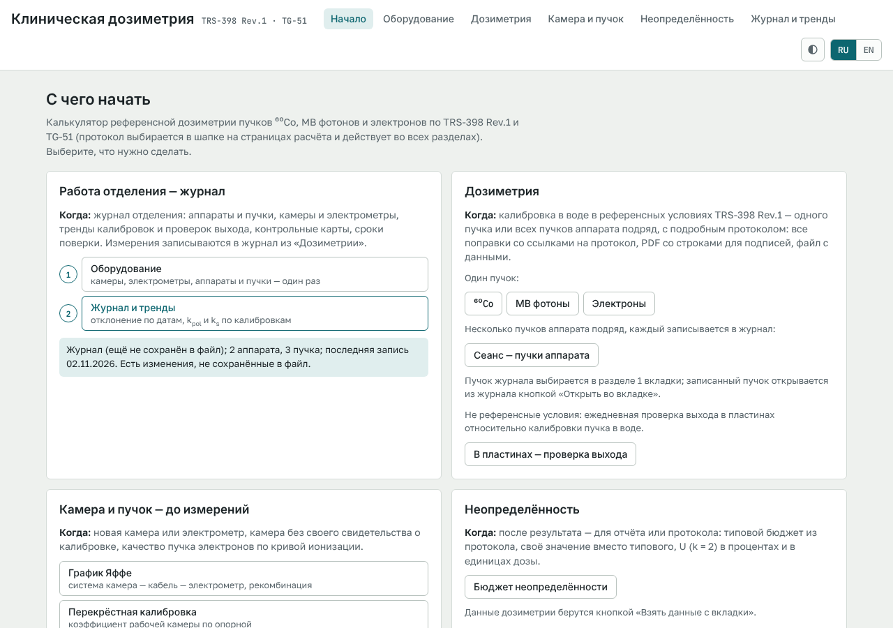

---

## 2. Оборудование

Раздел **«Оборудование»** заполняют один раз и затем правят только при изменениях: новая камера, новое свидетельство о калибровке, новый пучок. Отсюда данные подставляются во вкладки дозиметрии, поэтому заводской номер, ND,w и kelec не нужно вводить при каждом измерении.

### 2.1. Файл журнала

Справа на странице — сводка оборудования, замечания и панель **«Файл журнала»**.

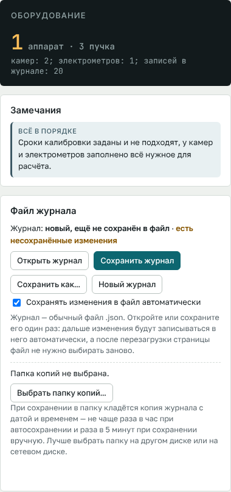

- **Новый журнал** — начать с нуля; **Открыть журнал** — открыть файл отделения (например, с общего диска); **Сохранить журнал / Сохранить как…** — записать в файл.
- В Chrome и Edge достаточно один раз открыть или сохранить файл: дальше при включённом флажке «Сохранять изменения в файл автоматически» каждое изменение записывается в него само. После перезагрузки страницы браузер попросит подтвердить доступ к файлу кнопкой «Продолжить с файлом…».
- В Firefox и Safari файл скачивается: им нужно заменить прежний файл журнала.
- **Папка копий** — по желанию: при сохранении туда кладётся копия журнала с датой и временем в имени (хранятся 50 последних). Лучше выбрать папку на другом или сетевом диске.

Пока журнал не сохранён в файл, его изменения есть только в этом браузере. В строке над кнопками об этом сказано: «есть несохранённые изменения».

### 2.2. Учреждение

Раздел 1 — учреждение и подразделение. Они попадают в протоколы записей и во вкладки дозиметрии при выборе пучка журнала.

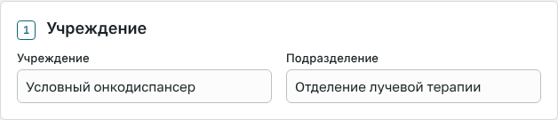

### 2.3. Аппараты и пучки

Раздел 2. Аппарат добавляют кнопкой нужного типа: **«Добавить ускоритель»**, **«Добавить аппарат ⁶⁰Co»** или **«Добавить рентгенотерапевтический аппарат»**.

У ускорителя:

1. Название аппарата (так оно будет в журнале и протоколах) и, по желанию, заводской №.
2. **Геометрия калибровки дозы** — одна на все пучки фотонов и одна на все пучки электронов: РИП или РИО 100 см, пересчитывать ли дозу на dmax (zmax) и где задан номинальный выход.
3. Пучки — кнопками **«+ Добавить пучок фотонов»** и **«+ Добавить пучок электронов»**. Название пишите так, как в протоколах отделения («6 МВ», «10 МВ БВФ», «9 МэВ»): «FFF» или «БВФ» в названии сам ставит отметку пучка без выравнивающего фильтра, энергия берётся из названия.
4. Отметка **«используется в измерениях»**: снятая убирает пучок из списков вкладок, но его история в журнале остаётся.
5. **«Настройки пучка — во вкладке…»** открывает пучок на вкладке дозиметрии: там задают V₁, V₂, полярность, МЕ, dmax и PDD(10) (или TMR), номинальный выход и допуск. Правки возвращаются кнопкой «Сохранить в журнал» над рабочим листом.

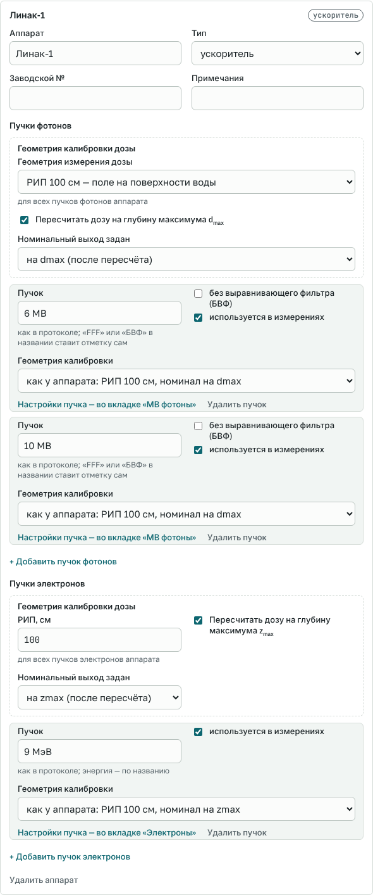

У **рентгенотерапевтического аппарата** вместо пучков — список аппликаторов (обозначение, форма, размер, РИП) и режимы: напряжение, ток трубки, фильтр, диапазон энергий, СПО (номинальный или измеренный), камера и электрометр режима, аппликаторы режима и референсный аппликатор. Пока чего-то не хватает для расчёта, под режимом перечислены замечания. Режимы удобнее заводить из вкладки «kV-рентген» кнопкой «Сохранить аппарат в «Оборудование»» (см. [3.7](#37-kv-рентген)).

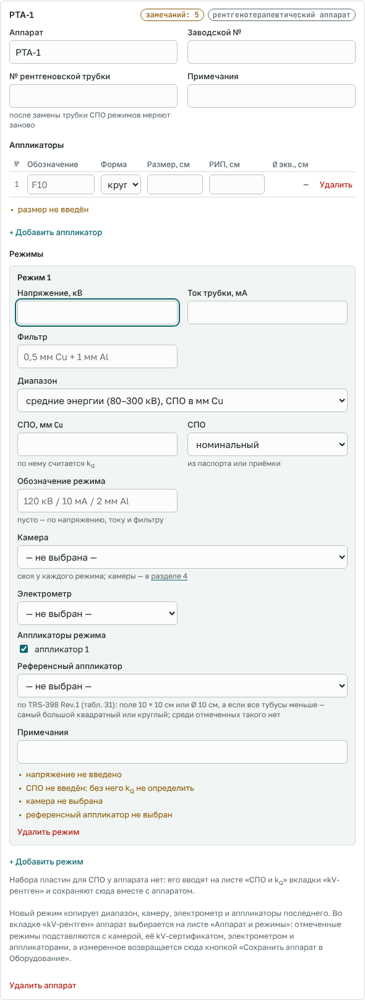

### 2.4. Электрометры

Раздел 3: производитель и модель из списка (или «Другой» со своим названием), заводской №, kelec, дата калибровки и срок «действует до».

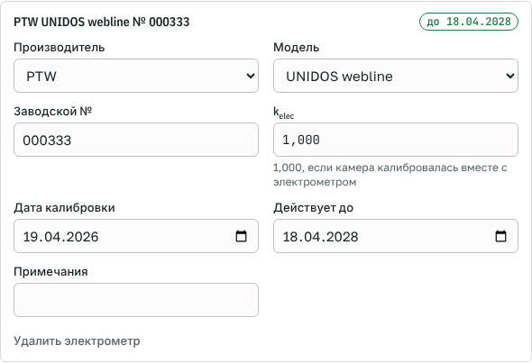

### 2.5. Камеры

Раздел 4. Одна запись камеры служит всем вкладкам — фотонам, электронам, ⁶⁰Co и kV: это та же физическая камера с тем же свидетельством.

1. Производитель и модель из базы. Под моделью показаны радиус и длина полости из базы (TRS-398 Rev.1, табл. 4).
2. Заводской №, способ калибровки (ND,w в ⁶⁰Co или перекрёстная калибровка), ND,w с единицами, kлаб, T₀ и P₀ из свидетельства.
3. **Свидетельство о калибровке** — лаборатория, № свидетельства, дата калибровки, срок «действует до», с каким электрометром, при каком напряжении и полярности калибровали. Свидетельство попадает в протокол записи; по нему вкладка дозиметрии предупредит, если выбран другой электрометр с kelec = 1 или рабочее напряжение не то, что при калибровке.
4. kV-сертификат (ND,w или NK по качествам) вводится во вкладке «kV-рентген» и сохраняется в эту же запись камеры.

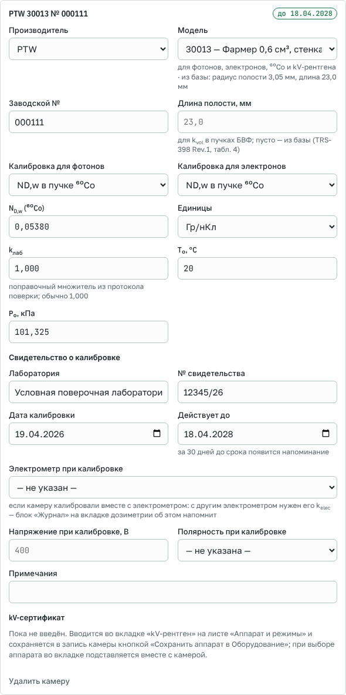

В заголовке карточки — срок калибровки или отметка «не заполнено: …». За 30 дней до срока появляется напоминание «срок подходит», после — «срок калибровки прошёл»; эти напоминания видны и в «Дозиметрии», и в «Журнале и трендах».

Камеру, электрометр, пучок или аппарат, которые уже есть в записях журнала, удалить нельзя: на них ссылаются протоколы и тренды. Выведенный из работы пучок отключают отметкой «используется в измерениях».

---

## 3. Дозиметрия

В разделе **«Дозиметрия»** — подразделы: **Сеанс**, **⁶⁰Co**, **МВ фотоны**, **Электроны**, **kV-рентген**, **В пластинах** (брахитерапия — в разработке). Каждая вкладка — рабочий лист с разделами по порядку измерения; слева — оглавление разделов с отметками заполненности, справа — результат, замечания и кнопки данных (пример, сохранение в файл, протокол, PDF). Числа можно вводить с запятой или точкой; обозначения с пунктирным подчёркиванием открывают справку.

Вкладка без журнала тоже работает: в ней можно посчитать разовое измерение и сохранить его в файл. Ниже — работа с журналом на примере вкладки «МВ фотоны».

### 3.1. Калибровка пучка МВ фотонов

**Шаг 1. Выбрать пучок журнала.** В разделе 1, в строке **«Журнал отделения»**, выберите аппарат и пучок. Во вкладку подставятся настройки пучка, камера и электрометр (те, которыми мерили в последней записи), учреждение и геометрия калибровки. Изменённые поля подсвечиваются. Укажите дату измерения и сотрудников.

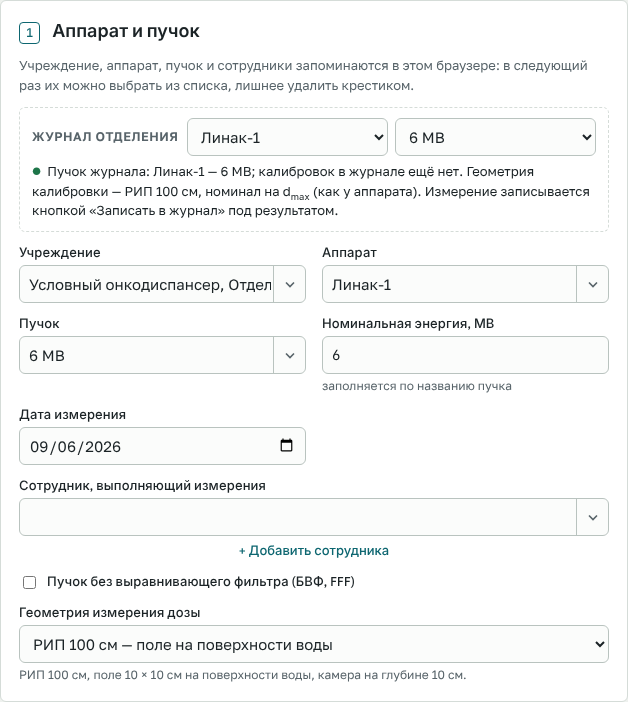

**Шаг 2. Камера и электрометр** (раздел 2) обычно уже заполнены из журнала. Если они отличаются от записи в «Оборудовании», вкладка покажет отличия и кнопки «Взять из журнала» или «Записать в журнал».

**Шаг 3. Показания электрометра** (раздел 3). Для калибровки вводятся три серии: при V₁ обычной полярности, при V₁ обратной полярности и при V₂. По ним считаются kpol и ks; под показаниями — средние, отношения и допустимые пределы. Флажок «Проверка выхода» при калибровке **снят**.

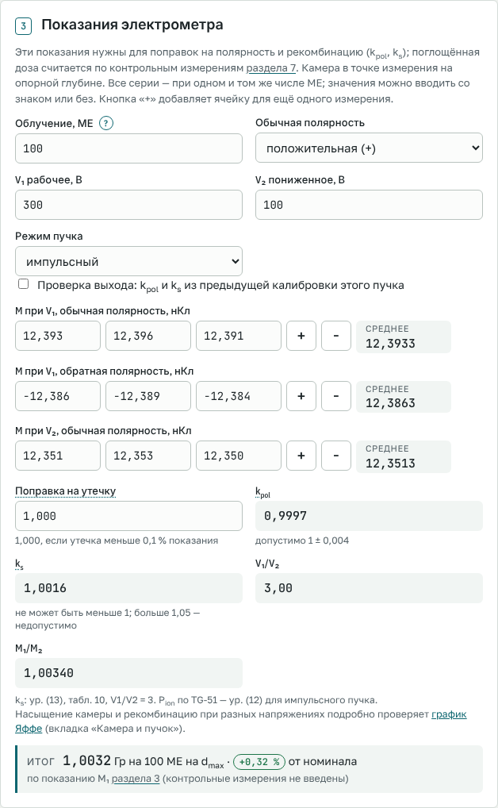

**Шаг 4. Качество пучка, температура и давление, пересчёт на dmax.** Качество пучка при калибровке измеряют (для TRS-398 — TPR20,10 по отношению показаний на 20 и 10 см или по PDD). T и P — в момент измерения. Глубина dmax, PDD(10) или TMR(10) и номинальный выход берутся из настроек пучка; при первом измерении нового пучка их вводят один раз и сохраняют кнопкой «Сохранить настройки пучка в журнал».

**Шаг 5. Проверить результат.** Справа — поглощённая доза в воде на опорной глубине и на dmax, отклонение от номинала, проверка референсных условий TRS-398 Rev.1. Ниже — **замечания**: предупреждения (жёлтые) и справки (серые) с номером раздела, куда смотреть. Если выход вне допуска, раздел 9 ведёт через проверку и подстройку ускорителя.

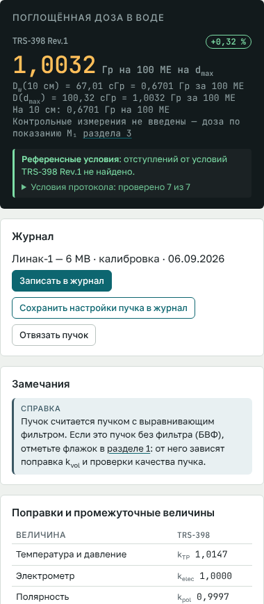

**Шаг 6. Записать в журнал.** Под результатом — блок **«Журнал»**: пучок, режим (калибровка или проверка выхода) и дата.

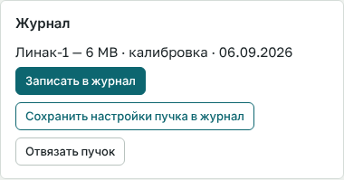

- **«Записать в журнал»** — сохраняет измерение: всю форму вкладки (по ней измерение потом открывается и пересчитывается) и итог. В строке состояния внизу появится подтверждение:

  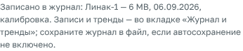

- **«Сохранить настройки пучка в журнал»** — запомнить настройки пучка (без показаний и условий) как значения по умолчанию.
- **«Отвязать пучок»** — вкладка снова считает сама по себе, без журнала.

Запись недоступна без даты, с датой в будущем, с ошибками в расчёте и для демонстрационного примера — в блоке сказано почему. Отклонение от номинала больше 20 % почти всегда означает ошибку ввода (МЕ, глубина номинала, камера, ND,w), поэтому такое измерение записывается только повторным нажатием «Подтвердить запись».

Пучки одного аппарата, измеренные в один день в одном режиме, собираются в **одну запись журнала** («аппарат за день»).

### 3.2. Проверка выхода

Для регулярной проверки выхода отметьте в разделе 3 флажок **«Проверка выхода: kpol и ks из предыдущей калибровки этого пучка»**. Тогда:

- вводится только одна серия — при V₁ и обычной полярности;
- kpol, ks, дата калибровки и качество пучка подставляются из **последней калибровки этого же пучка** в журнале; у каждой энергии — свои;
- если калибровка была до начала журнала, kpol, ks и дату калибровки вводят в те же поля вручную.

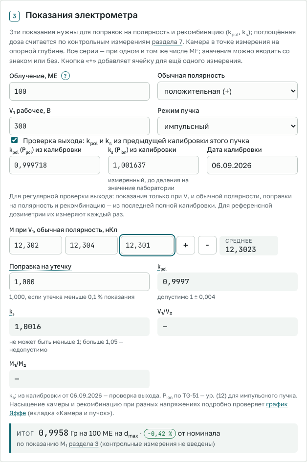

В блоке «Журнал» режим записи сменится на «проверка выхода»:

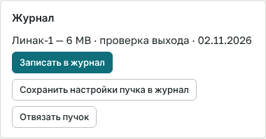

Если сменить дату, а показания остались от прошлой записи, вкладка очистит показания, T и P и скажет об этом в строке состояния: показания прошлого дня не попадут в новое измерение.

### 3.3. Электроны

Вкладка «Электроны» работает так же: пучок журнала в разделе 1, камера (для электронов по умолчанию плоскопараллельная из журнала), показания трёх серий при калибровке или одной серии при проверке выхода. Качество пучка — R50 или I50; опорная глубина zref считается по нему, пересчёт на zmax — по PDD(zref). Результат и блок «Журнал» — справа.

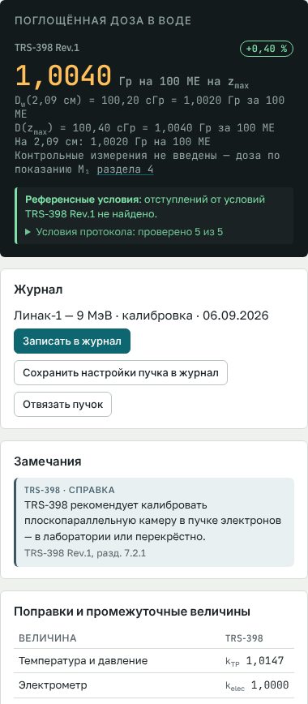

Расчёт kQ не по TRS-398 Rev.1 (Report 385, табл. 18 первого издания TRS-398) всегда помечен предупреждением и статусом «нестандартные условия».

### 3.4. ⁶⁰Co

Вкладка «⁶⁰Co»: вместо МЕ — время облучения, kQ = 1, качество пучка не измеряют. При калибровке определяют ошибку таймера τ; при проверке выхода τ, kpol и ks берутся из последней калибровки. Мощность дозы сравнивается с последней калибровкой в журнале, приведённой к дате измерения по распаду ⁶⁰Co. Подробно — [cobalt.md](cobalt.md).

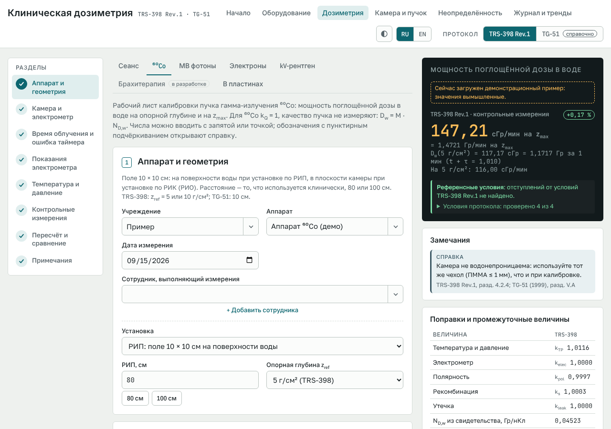

### 3.5. Сеанс: все пучки аппарата подряд

**«Сеанс»** — калибровка или проверка выхода нескольких пучков одного аппарата подряд, в воде, в референсных условиях. Своего расчёта у сеанса нет: каждый пучок измеряется в своей вкладке, как одиночный.

1. Выберите аппарат, дату и режим (калибровка или проверка выхода в воде).
2. В списке отмечены все действующие пучки аппарата; рядом — дата последней калибровки. Ненужные пучки снимите, порядок поменяйте стрелками.
3. Нажмите **«Начать сеанс»**.

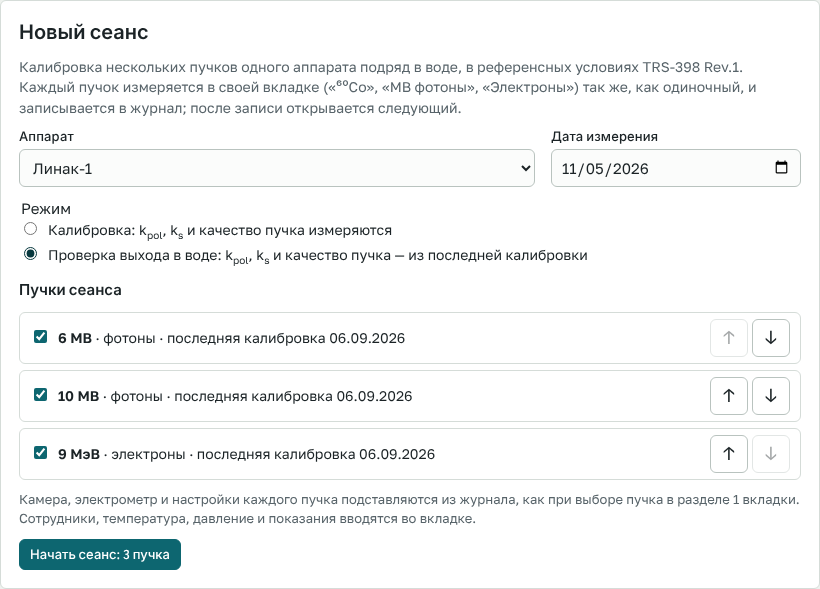

Первый пучок открывается в своей вкладке с выбранным пучком журнала, датой и режимом сеанса. Над рабочим листом — **полоса сеанса**: аппарат, дата, режим, «пучок N из M», значки пучков (записан — с отклонением от номинала, текущий, не измерен). Введите T, P и показания, затем **«Записать и далее»**: измерение записывается в журнал и открывается следующий пучок. «Пропустить» — перейти к следующему без записи.

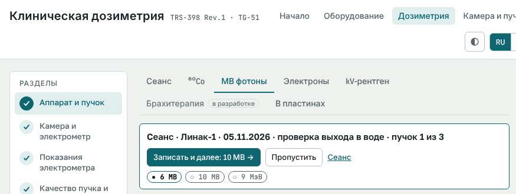

Все пучки сеанса попадают в одну запись журнала. Сеанс можно прервать в любой момент: записанные пучки остаются в журнале, а сеанс, начатый заново на ту же дату, продолжится с первого невыполненного пучка.

### 3.6. В пластинах: ежедневная проверка выхода

**«В пластинах»** — проверка выхода в пластиковом фантоме (RW3, ПММА, полистирол). Это **не референсные условия**: страница всегда помечена «Нестандартные условия», а выход считается только относительно калибровки пучка в воде (TRS-398 Rev.1, разд. 4.2.3).

1. Выберите пучок журнала.
2. **Привязка** (раздел 2) — один раз, сразу после калибровки в воде тем же дозиметром: калибровка в воде из журнала, материал и измеренная плотность пластин, толщина над и под камерой, МЕ, T, P и показания. Кнопка **«Сохранить привязку»** сохраняет её у пучка.

   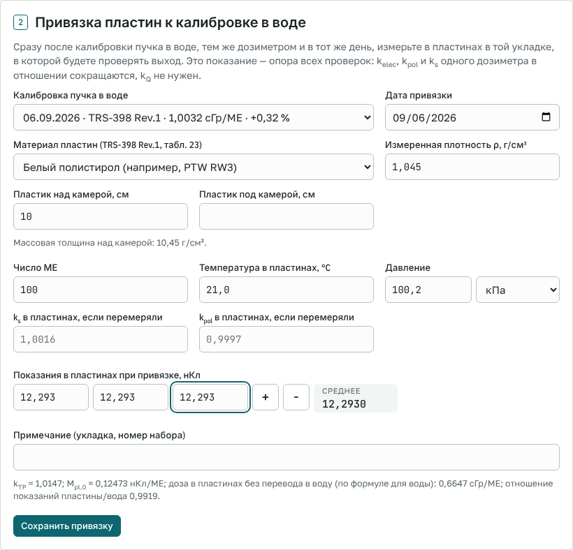

3. **Проверка выхода** (раздел 3) — каждый раз: дата, МЕ, T и P в пластинах, показания. Результат — доза в воде на 1 МЕ в точке номинала и отклонение от номинала; справочно — доза в пластинах без перевода в воду. Кнопка **«Записать в журнал»**.

   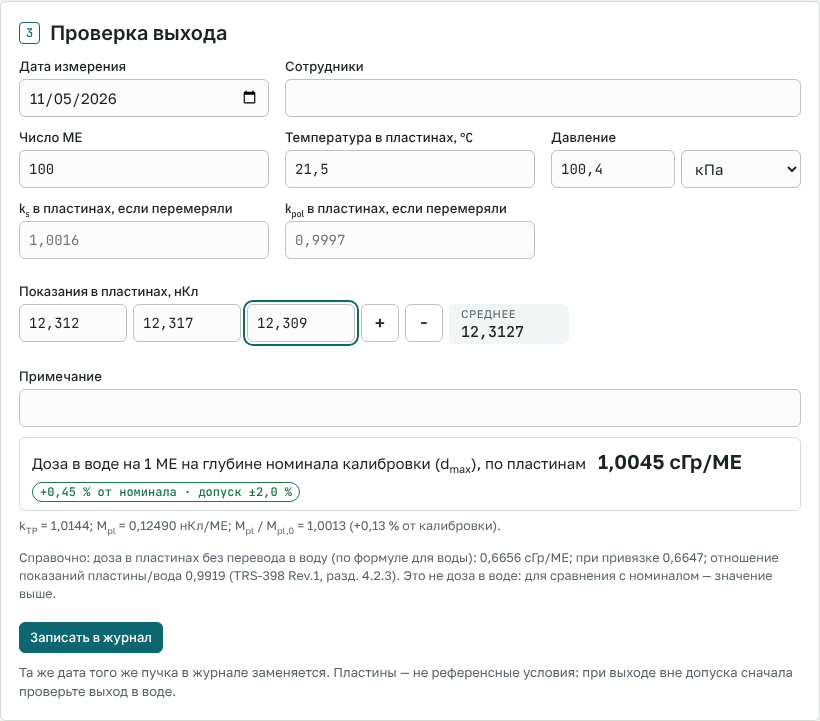

Если выход в пластинах вне допуска, сначала проверьте выход в воде и только потом подстраивайте ускоритель. Если пучок после привязки калибровали в воде заново, страница попросит повторить привязку.

### 3.7. kV-рентген

Вкладка «kV-рентген» устроена листами, как рабочая книга Excel: **«Аппарат и режимы»**, **«СПО и kQ»**, **«Ошибка таймера»**, **«Линейность»**, **«Воспроизводимость»**, **«Поглощённая доза»**, **«Сводка и протокол»**. Зелёная точка на ярлыке листа — лист заполнен.

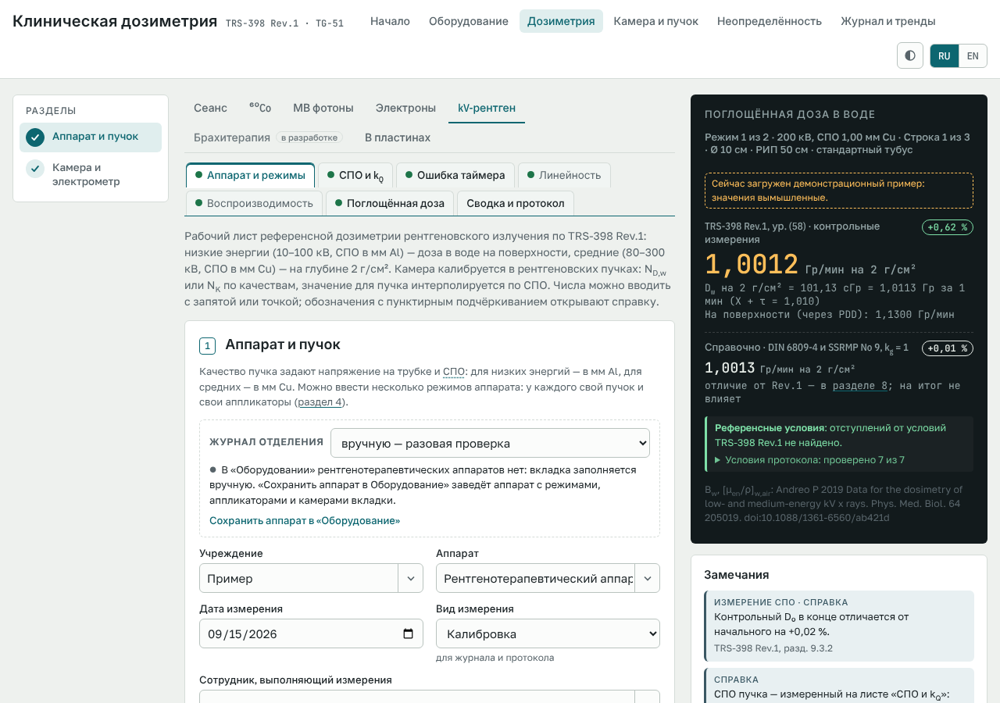

С журналом: в строке «Журнал отделения» на листе «Аппарат и режимы» выберите рентгенотерапевтический аппарат из «Оборудования» — подставятся его режимы, камеры с kV-сертификатами, электрометры и аппликаторы. Если аппарата в журнале ещё нет, заполните вкладку и нажмите **«Сохранить аппарат в «Оборудование»»**. Измерение записывается в журнал по режимам; при проверке выхода kpol, ks, τ и СПО берутся из последней калибровки режима. Подробно — [kv.md](kv.md).

---

## 4. Журнал и тренды

Раздел **«Журнал и тренды»** показывает историю записей одного аппарата. Выберите аппарат и группу пучков (фотоны, электроны, ⁶⁰Co — только те, что есть у аппарата).

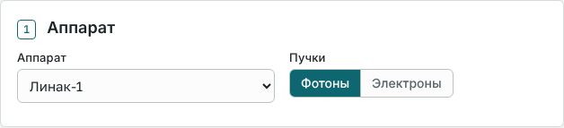

### 4.1. Выход по датам

Отклонение дозы от номинала по датам для каждого пучка: сплошные значки — калибровки, полые — проверки выхода, пунктир — допуск. При наведении курсора видны значения всех пучков на ближайшую дату; под графиком — «Таблица значений».

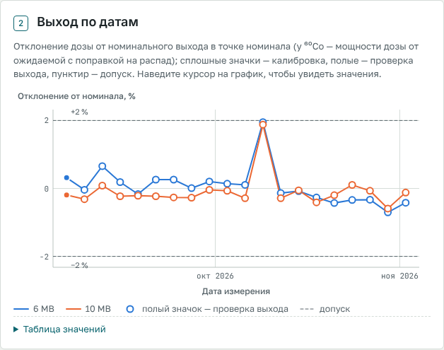

### 4.2. Контрольная карта

Выход одного пучка относительно его обычного уровня: центральная линия (среднее первых 20 записей отсчёта) и границы ±2σ и ±3σ, где σ — обычный разброс от записи к записи. Карта замечает сдвиг или дрейф раньше, чем выход уйдёт за допуск.

- **Сигналы** (красные квадраты) — точка за 3σ или накопленная сумма (CUSUM) для небольшого устойчивого сдвига. Под картой — список сигналов с датами.
- **Наблюдения** — не сигнал, а повод посмотреть следующие записи («2 из 3 точек за 2σ», «8 точек подряд по одну сторону» и т. п.).
- **Тренд** — наклон в %/мес и его значимость; считается, когда в отсчёте не меньше 10 записей за 30 дней.
- **Отсчёт начинается заново** после подстройки ускорителя, смены камеры, электрометра, ND,w или kelec, геометрии калибровки и по кнопке «Новый отсчёт карты» у записи (например, после ремонта).
- «Как читать карту» внизу раздела — краткая справка.

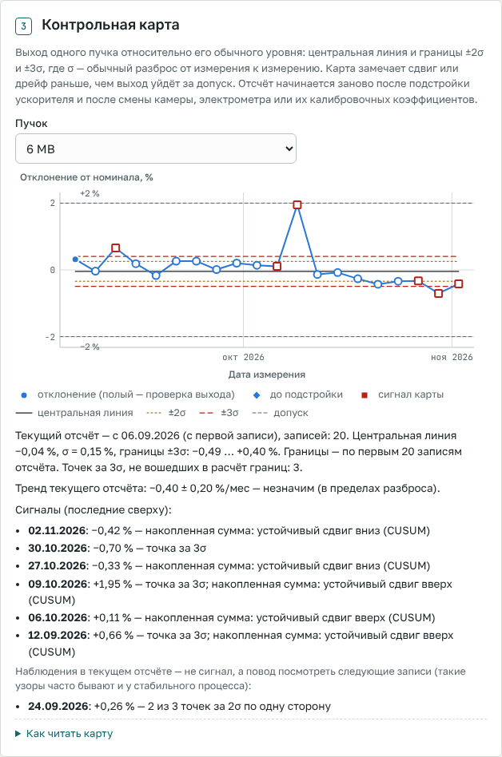

### 4.3. Общая часть записей

Отклонение каждого пучка от его обычного уровня делится на **общую для записи часть** (медиана по пучкам) и собственную часть пучка. Если сдвинулись все пучки вместе — причина скорее общая: дозиметр, термометр, барометр, ND,w или мониторная камера ускорителя. Если ушёл один пучок — причина в нём. На примере ниже 09.10.2026 все пучки сдвинулись на +2 % вместе — это сигнал на карте общей части, а не на картах отдельных пучков.

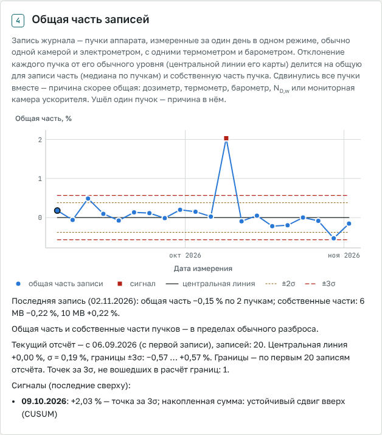

### 4.4. kpol, ks и τ по калибровкам

Таблица поправок, измеренных при калибровках (у ⁶⁰Co — и ошибка таймера τ). Их изменение от калибровки к калибровке — ранний признак неполадки камеры, кабеля, электрометра или привода источника.

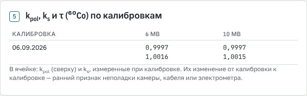

### 4.5. Записи журнала и протокол

Список записей аппарата (новые сверху): дата, режим, число пучков, значение и отклонение каждого пучка. Кнопки:

- **«Открыть во вкладке»** — пучок записи открывается на своей вкладке дозиметрии по записанной форме, со всеми поправками и замечаниями; изменения там в журнал не попадают, кнопка над рабочим листом возвращает прежние данные вкладки;
- **«Протокол»** — протокол записи (аппарат за день);
- **«Новый отсчёт карты»** — начать контрольную карту заново с этой записи;
- **«Удалить»** — срабатывает по повторному нажатию;
- **«Выгрузить журнал в CSV»** (под списком) — все записи всех аппаратов для Excel: по строке на пучок.

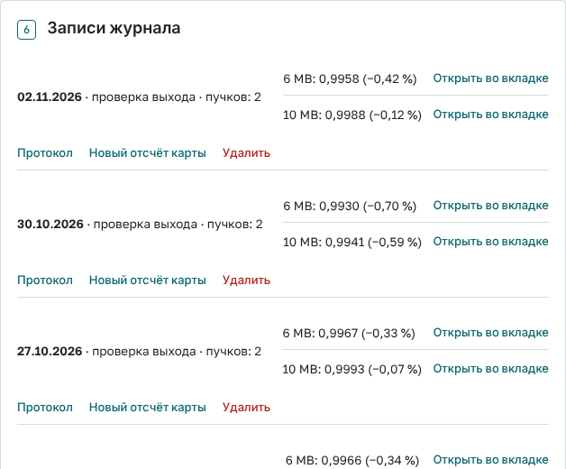

Протокол записи — учреждение, аппарат, дата, режим, протокол, сотрудники, условия; по каждому пучку — камера со свидетельством о калибровке, электрометр, доза, отклонение и допуск, поправки, kQ, качество пучка; строки для подписи. Его можно скопировать текстом или сохранить в PDF. Подробный протокол одного пучка со всеми таблицами — PDF вкладки дозиметрии.

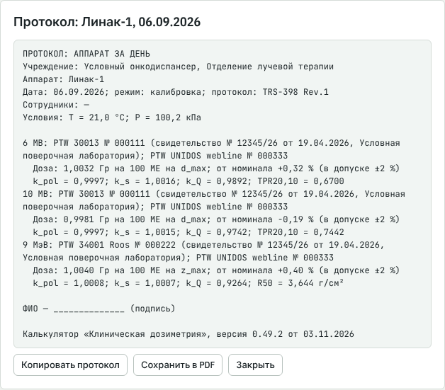

### 4.6. Контроль дозиметра и проверки в пластинах

- **Контроль дозиметра** (раздел 7) — карта отношения доз рабочей и второй камеры, если при измерениях делали проверку дозиметра второй камерой (раздел в конце вкладок дозиметрии). Без таких проверок раздел показывает одну строку-пояснение.
- **Проверки в пластинах** (раздел 8) — таблица проверок выхода в пластинах со ссылкой на подраздел «В пластинах», где у каждого пучка своя контрольная карта.

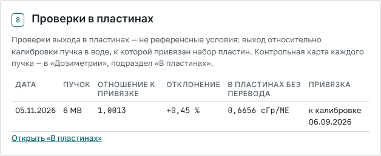

Для рентгенотерапевтического аппарата разделы другие: выход по режимам, контрольная карта режима, общая часть режимов, сводная по датам («режим × аппликатор», с копией для Excel), режим по датам и записи журнала — см. [kv.md](kv.md#журнал-и-тренды-для-kv-с-0480).

---

## 5. Частые вопросы

**Где хранятся данные?** Журнал — в файле `.json`, который вы открыли или сохранили; в браузере — только его рабочая копия. Черновики вкладок, списки учреждений и сотрудников хранятся в этом браузере: на другом компьютере их не будет. Чтобы перенести отдельное измерение, сохраните его кнопкой «Сохранить данные (.json)» и откройте на другом устройстве.

**Можно ли держать журнал на общем диске?** Да. Перед каждой записью сверяется время изменения файла: если его изменили на другом компьютере, поверх он не запишется, а панель предложит взять версию из файла или записать свою. Одновременная правка одного файла несколькими людьми не объединяется.

**Пучка нет в списке вкладки.** Проверьте в «Оборудовании», что пучок нужного вида (фотоны, электроны, ⁶⁰Co) и у него стоит отметка «используется в измерениях».

**Проверка выхода не считается: нет kpol и ks.** Для проверки выхода нужны kpol и ks из калибровки. Без них — ошибка, и измерение не записывается. Запишите калибровку пучка в журнал или введите kpol, ks и дату прежней калибровки вручную в разделе 3.

**Как внести старые протоколы, чтобы построился тренд?** Дата записи в журнале — это поле **«Дата измерения»** в разделе 1 вкладки (на вкладке kV — на листе «Аппарат и режимы»). По умолчанию там стоит сегодняшняя дата, её можно заменить на дату протокола (дату в будущем журнал не принимает).

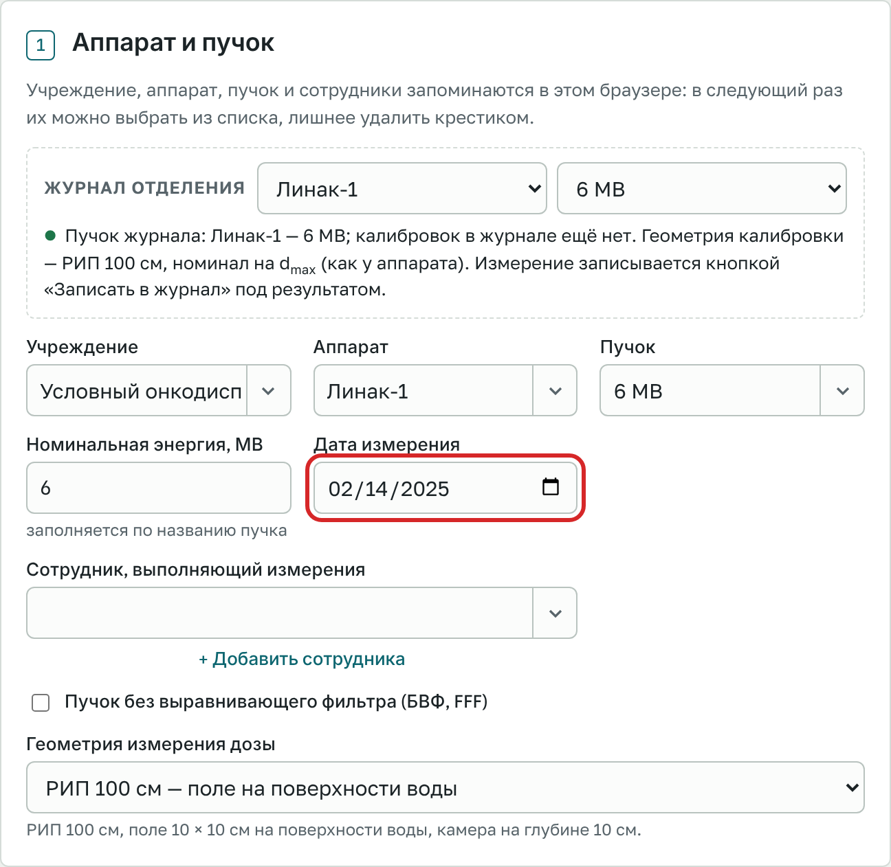

1. Выберите аппарат и пучок журнала, поставьте дату первого протокола и только потом введите показания, условия и МЕ. Нажмите «Записать в журнал».
2. Смените дату на дату следующего протокола и введите его показания. Если показания прежнего протокола остались во вкладке, при смене даты они очищаются, и в строке состояния об этом сказано: старые данные не попадут в новую дату.
3. Вносите протоколы от старых к новым: для проверки выхода kpol, ks и качество пучка берутся из последней калибровки до её даты, поэтому калибровку вносят раньше опирающихся на неё проверок.

Измерение с другой датой — новая запись, прежние не меняются. Тот же пучок за ту же дату в том же режиме (калибровка или проверка выхода) и по тому же протоколу заменяет прежнюю запись: тогда в блоке «Журнал» об этом сказано и кнопка называется «Заменить запись в журнале».

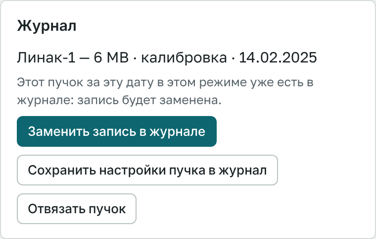

Записи разных дат ложатся на график «Выход по датам» в «Журнале и трендах» (снимок — четыре калибровки 2025 года, внесённые задним числом; версия 0.50.0).

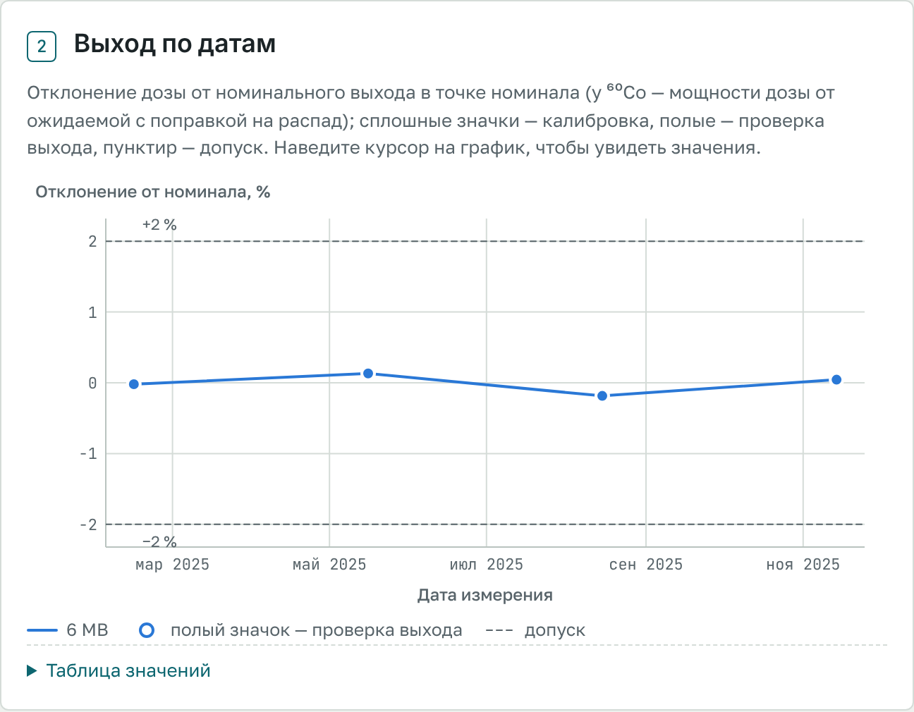

**Как посмотреть старое измерение?** «Журнал и тренды» → «Записи журнала» → «Открыть во вкладке» у нужного пучка. Измерение откроется по записанной форме и покажет ту же дозу, даже если камеру потом перекалибровали.

**Как исправить ошибочную запись?** Откройте её во вкладке, проверьте ввод, исправьте и запишите заново на ту же дату: повторная запись того же пучка за ту же дату заменяет прежнюю (кнопка «Заменить запись в журнале») или удалите ошибочную запись в списке записей.

**Калькулятор заменяет протокол отделения?** Нет. Результат нужно проверить по процедуре отделения; ответственность за клиническую калибровку несёт медицинский физик.
