# Инструкция пользователя: Оборудование, Дозиметрия, Журнал и тренды

Пошаговое описание ежедневной работы с калькулятором «Клиническая дозиметрия»: как один раз завести оборудование отделения, как измерить и записать калибровку или проверку выхода пучка и как смотреть тренды и контрольные карты. Формулы, коэффициенты и ссылки на разделы протоколов — в технических описаниях: [photons.md](photons.md), [electrons.md](electrons.md), [cobalt.md](cobalt.md), [kv.md](kv.md), [brachy.md](brachy.md), [journal.md](journal.md).

Снимки экрана сделаны в версии 0.65.0 на **вымышленных данных**: «Условный онкодиспансер», сотрудники Иванова А. А. и Петров П. П., ускоритель «Линак-1» с пучками 6 МВ, 10 МВ и 9 МэВ, рентгенотерапевтический аппарат «РТА-1», камеры PTW 30013 № 000111 и PTW 34001 Roos № 000222, электрометр PTW UNIDOS webline № 000333. В журнале — калибровка 06.09.2026, проверки выхода каждые три дня до 02.11.2026 (09.10.2026 все пучки вместе выше на 2 %) и проверки 6 МВ в пластинах 09–13.11.2026. Числа на снимках не относятся ни к одному реальному аппарату. Формат даты в полях ввода зависит от настроек браузера (на снимках — ММ/ДД/ГГГГ). Снимки раздела «Брахитерапия» (2.3, 2.5, 3.8) — версии 0.77.0: «Афтерлоадер-1» с источниками mHDR-v2 № D36A-0001 и № D36A-0002, колодезная камера PTW TW33004 № 000444, измерения каждую неделю с 05.09 по 24.10.2026.

Содержание:

1. [Общий порядок работы](#1-общий-порядок-работы)
2. [Оборудование](#2-оборудование)
3. [Дозиметрия](#3-дозиметрия)
4. [Журнал и тренды](#4-журнал-и-тренды)
5. [Частые вопросы](#5-частые-вопросы)

---

## 1. Общий порядок работы

Сайт: https://mesava.github.io/Reference-dosimetry/ (без интернета — файл [`dist/index.html`](../dist/index.html), открывается двойным щелчком). Всё считается в браузере, данные никуда не отправляются.

Порядок такой:

1. **Оборудование** — один раз: учреждение, аппараты и пучки, электрометры, камеры. Всё это хранится в **файле журнала** (`.json`) отделения.
2. **Дозиметрия** — при каждом измерении: выбрать пучок журнала, ввести условия и показания, проверить результат и нажать **«Записать в журнал»**.
3. **Журнал и тренды** — когда нужно посмотреть историю: отклонение выхода по датам, контрольные карты, протоколы записей, выгрузка в Excel.

В шапке страницы — разделы, переключатель светлой и тёмной темы и языка (RU/EN). **Основной протокол — TRS-398 Rev.1.** На страницах, где выбор протокола меняет расчёт (вкладки «⁶⁰Co», «МВ фотоны» и «Электроны» в воде, «Инструменты»), в шапке появляется ещё переключатель протокола: TG-51 включается только для справочного сравнения и помечен «справочно». На остальных страницах (Начало, Оборудование, kV-рентген, Журнал и тренды) переключателя нет: там всё по TRS-398 Rev.1.

На **телефоне** (узкий экран) разделы, язык и тема спрятаны в меню: кнопка **☰** слева от названия открывает список, выбор раздела закрывает его.

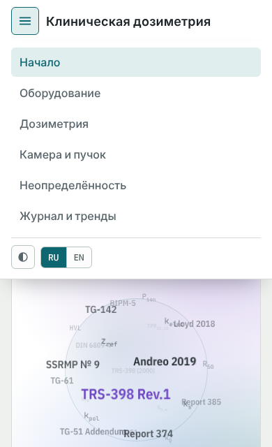

У каждого вида пучка свой цвет: **⁶⁰Co — синий**, **МВ фотоны — фиолетовый**, **электроны — янтарный**, **kV-рентген — зелёный**. На вкладке пучка (и на её листах «Сеанс» и «В пластинах») в этот цвет окрашены ярлыки, кнопки, номера разделов и табло с результатом, так что по цвету сразу видно, какой пучок сейчас считается. Цвет — только подсказка: у ярлыков остаются подпись и пиктограмма. Печать и PDF протоколов от цвета не зависят.

На странице **«Начало»** вверху — сфера из названий документов, по которым считает калькулятор (её можно повернуть мышью или пальцем, щелчок по названию открывает «Литературу»), ниже — с чего начать и состояние журнала: имя файла, сколько аппаратов и пучков, когда была последняя запись, есть ли несохранённые изменения.

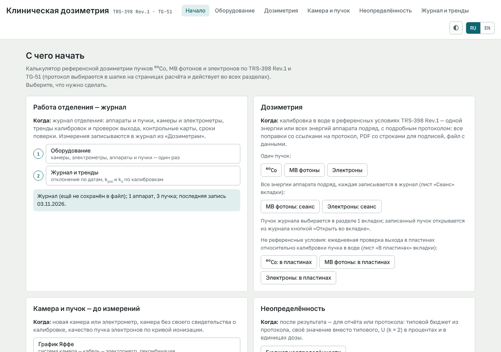

Внизу каждой страницы — ссылка на страницу **«Литература»**: все источники калькулятора (протоколы, аддендумы, статьи) карточками с обложками, сгруппированные по темам.

---

## 2. Оборудование

Раздел **«Оборудование»** заполняют один раз и затем правят только при изменениях: новая камера, новое свидетельство о калибровке, новый пучок, новый сотрудник. Отсюда данные подставляются во вкладки дозиметрии, поэтому заводской номер, ND,w и kelec не нужно вводить при каждом измерении.

В разделах 2–4 (аппараты, электрометры, камеры) **каждая запись — свой лист**: над карточкой ряд ярлыков с названиями, щелчок по ярлыку открывает карточку. Кнопки «+ Добавить…» — всегда над ярлыками; новая запись сразу открывается своим листом. Точка на ярлыке показывает, заполнена ли карточка: зелёная — всё нужное для расчёта есть; чего не хватает — сказано в заголовке карточки и в «Замечаниях» справа.

Внизу каждой карточки (аппарат, режим рентгенотерапевтического аппарата, электрометр, камера) — поле **«Примечания»** во всю ширину карточки: текст переносится по строкам, поле растёт по мере ввода, Enter начинает новую строку. Длинный комментарий виден целиком.

### 2.1. Файл журнала

Справа на странице — сводка оборудования, замечания (в том числе о сроках калибровки) и панель **«Файл журнала»**.

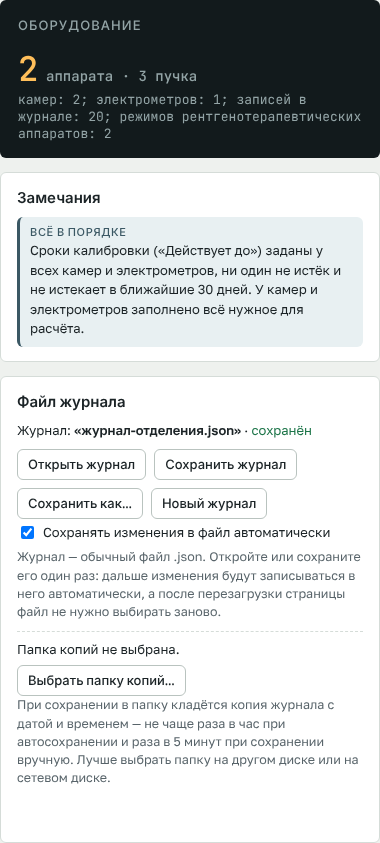

- **Новый журнал** — начать с нуля; **Открыть журнал** — открыть файл отделения (например, с общего диска); **Сохранить журнал / Сохранить как…** — записать в файл.
- В Chrome и Edge достаточно один раз открыть или сохранить файл: дальше при включённом флажке «Сохранять изменения в файл автоматически» каждое изменение записывается в него само. После перезагрузки страницы браузер попросит подтвердить доступ к файлу кнопкой «Продолжить с файлом…».
- В Firefox и Safari файл скачивается: им нужно заменить прежний файл журнала.
- **Папка копий** — по желанию: при сохранении туда кладётся копия журнала с датой и временем в имени (хранятся 50 последних). Лучше выбрать папку на другом или сетевом диске.

Пока журнал не сохранён в файл, его изменения есть только в этом браузере. В строке над кнопками об этом сказано: «есть несохранённые изменения».

### 2.2. Учреждение

Раздел 1 — учреждение, подразделение и **сотрудники** отделения. Учреждение и подразделение попадают в протоколы записей и во вкладки дозиметрии при выборе пучка журнала. Сотрудники («+ Добавить сотрудника», лишнего удаляют крестиком) появляются в выпадающем списке поля «Сотрудник, выполняющий измерения» всех вкладок дозиметрии и листа «В пластинах» с пометкой «отделение». Само поле ничего не подставляет: сотрудника выбирают из списка или вписывают другого.

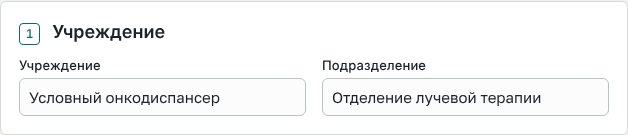

### 2.3. Аппараты и пучки

Раздел 2. Аппарат добавляют кнопкой нужного типа: **«+ Добавить ускоритель»**, **«+ Добавить аппарат ⁶⁰Co»** или **«+ Добавить рентгенотерапевтический аппарат»**. Тип задаётся только кнопкой и потом не меняется (он виден на ярлыке и в заголовке карточки).

У ускорителя:

1. Название аппарата (так оно будет в журнале и протоколах) и, по желанию, заводской №.
2. **Геометрия калибровки дозы** — одна на все пучки фотонов и одна на все пучки электронов: РИП или РИО 100 см, пересчитывать ли дозу на dmax (zmax) и где задан номинальный выход.
3. Пучки — кнопками **«+ Добавить пучок фотонов»** и **«+ Добавить пучок электронов»**. Название пишите так, как в протоколах отделения («6 МВ», «10 МВ БВФ», «9 МэВ»): «FFF» или «БВФ» в названии сам ставит отметку пучка без выравнивающего фильтра, энергия берётся из названия.
4. Отметка **«используется в измерениях»**: снятая убирает пучок из списков вкладок, но его история в журнале остаётся.
5. **«Настройки пучка — во вкладке…»** открывает пучок на вкладке дозиметрии: там задают V₁, V₂, полярность, МЕ, dmax и PDD(10) (или TMR), номинальный выход и допуск. Правки возвращаются кнопкой «Сохранить в журнал» над рабочим листом.

У **рентгенотерапевтического аппарата** вместо пучков:

- **Аппликаторы** — таблица: обозначение, форма, размер, РИП; эквивалентный диаметр считается сам.
- **Режимы** — каждый режим тоже свой ярлык внутри карточки аппарата («Режим 1 · 200 кВ / 10 мА / 0,5 мм Cu + 1 мм Al»): напряжение, ток трубки, фильтр, диапазон энергий, СПО (номинальный — из паспорта или приёмки, или измеренный — с датой измерения), аппликаторы режима и стандартный аппликатор. Пока чего-то не хватает для расчёта, под режимом перечислены замечания.
- **Камеры режимов** — таблица внизу карточки: камера каждого режима, её электрометр (электрометр при калибровке kV-сертификата) и есть ли у камеры kV-сертификат.
- Набор пластин для измерения СПО, если его вводили на листе «СПО и kQ» вкладки «kV-рентген».

«Оборудование» — источник постоянного для вкладки «kV-рентген»: при выборе аппарата во вкладке режимы подставляются с камерой, её kV-сертификатом, электрометром и аппликаторами и там только показываются. Аппарат можно завести и из вкладки кнопкой «Сохранить аппарат в «Оборудование»» (см. [3.7](#37-kv-рентген)).

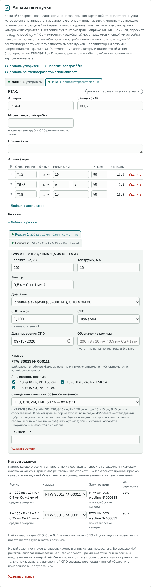

У **афтерлоадера** (кнопка **«+ Добавить афтерлоадер»**, с версии 0.75.0) вместо пучков — **источники**: нуклид, модель (из списка HEBD и TRS-492 или своя), заводской №, значение и дата сертификата, даты установки и замены. Новый источник добавляется сверху с моделью прежнего, у прежнего ставится дата замены; источник, стоящий в аппарате сейчас, отмечен «в аппарате». На листах вкладки «Брахитерапия» источник на дату измерения выбирается сам.

### 2.4. Электрометры

Раздел 3: производитель и модель из списка (или «Другой» со своим названием), заводской №, kelec, дата калибровки и срок «действует до».

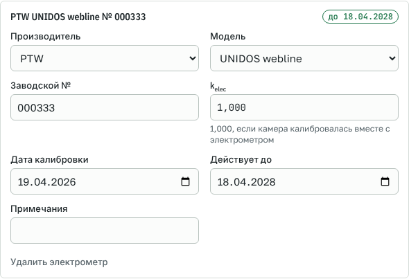

### 2.5. Камеры

Раздел 4. Одна запись камеры служит всем пучкам, для которых она отмечена: это та же физическая камера. Но свидетельств у неё может быть два — для МВ и ⁶⁰Co и для kV-рентгена, — и они хранятся отдельно.

1. Производитель и модель из базы. Под моделью показаны радиус и длина полости из базы (TRS-398 Rev.1, табл. 4). Поля свидетельства появляются после выбора модели.
2. Заводской № и **«Применение»**: флажки «МВ фотоны и ⁶⁰Co», «электроны», «kV-рентген» (только те, для которых модель годится). Ниже — поля только для отмеченного, и списки камер во вкладках дозиметрии показывают камеру только для отмеченных видов пучков. Флажок нельзя снять, если камерой уже мерили этим видом пучков или она выбрана в режиме рентгенотерапевтического аппарата.
3. Свидетельства — на двух ярлыках внутри карточки:
   - **«Ускорители и ⁶⁰Co»** — способ калибровки (ND,w в ⁶⁰Co или перекрёстная), ND,w с единицами, kлаб, T₀ и P₀, лаборатория, № свидетельства, дата калибровки, срок «действует до», с каким электрометром, при каком напряжении и полярности калибровали. Свидетельство попадает в протокол записи; по нему вкладка дозиметрии предупредит, если выбран другой электрометр с kelec = 1 или рабочее напряжение не то, что при калибровке.
   - **«kV-рентген»** — kV-сертификат: свои лаборатория, №, даты, электрометр, ND,w или NK, таблица качеств (кВ, СПО, металл, kQ или N), условия лаборатории, свои T₀ и P₀.

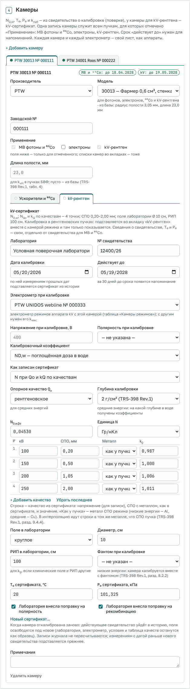

**Колодезная камера** (PTW TW33004 SourceCheck 4π, Standard Imaging HDR 1000 Plus, IVB 1000 или своя, с версии 0.75.0) заводится в том же разделе 4, но вместо свидетельства для пучков у неё **«Сертификат колодезной камеры»**: по строке на каждое сочетание аппарата, адаптера (держателя источника) и нуклида — N, U(N), модель источника при калибровке (для ksm,sm0) и опорная точка; ниже — T₀, P₀, лаборатория, №, даты калибровки и срока. «Применения» у колодезной камеры нет. Камере для фантома PTW 9193 (например, PTW 30013) отметьте в «Применении» **«брахитерапия»**: для неё нужен ND,w в ⁶⁰Co.

**Камеру перекалибровали.** Нажмите **«Новый сертификат…»** на нужном ярлыке: действующее свидетельство уйдёт в «Историю сертификатов», поля освободятся под новое. Записи журнала не пересчитываются: у каждой записи свои № и коэффициенты свидетельства. Вкладки дозиметрии берут свидетельство, действовавшее **на дату измерения**: если внести измерение прошлой даты, подставится прежнее свидетельство из истории. У записи истории есть кнопки «Сделать действующим» (если новое внесли по ошибке) и «Удалить».

В заголовке карточки — сроки свидетельств (у камеры с двумя свидетельствами — оба: «МВ и ⁶⁰Co: до …», «kV: до …») или отметка «не заполнено: …». За 30 дней до срока появляется напоминание «срок подходит», после — «срок калибровки прошёл»; эти напоминания видны и в «Дозиметрии», и в «Журнале и трендах».

Камеру, электрометр, пучок или аппарат, которые уже есть в записях журнала, удалить нельзя: на них ссылаются протоколы и тренды. Выведенный из работы пучок отключают отметкой «используется в измерениях».

**Камера сломалась или больше не используется** (с версии 0.68.0): откройте её карточку и нажмите **«Списать камеру»** (у электрометра — «Списать электрометр»). Дата списания ставится сегодняшняя, её можно поправить в карточке. Списанная камера остаётся в журнале: записи, протоколы, тренды и контрольные карты с ней не меняются. Но в новых измерениях она больше не предлагается (списки «Журнал отделения» во вкладках, проверка второй камерой, «Камеры режимов» kV), не напоминает о сроке свидетельства, а её ярлык уходит в конец ряда с пометкой «списана». Если камеру списали по ошибке — «Вернуть в работу».

---

## 3. Дозиметрия

В разделе **«Дозиметрия»** — подразделы: **⁶⁰Co**, **МВ фотоны**, **Электроны**, **kV-рентген**, **Брахитерапия** (в разработке, см. [3.8](#38-брахитерапия)). У вкладок пучков под подразделами — ярлыки листов (с версии 0.63.0): у «МВ фотонов» и «Электронов» — **«Одна энергия»** (рабочий лист), **«Сеанс: все энергии»** и **«В пластинах»**; у «⁶⁰Co» — **«В воде»** и **«В пластинах»**. Щелчок по подразделу открывает лист, с которым работали последним. Каждая вкладка — рабочий лист с разделами по порядку измерения; слева — оглавление разделов с отметками заполненности, справа — результат, блок «Журнал», замечания и кнопки данных (пример, сохранение в файл, протокол, PDF). Числа можно вводить с запятой или точкой; обозначения с пунктирным подчёркиванием открывают справку.

Вкладка без журнала тоже работает: в ней можно посчитать разовое измерение и сохранить его в файл. Ниже — работа с журналом на примере вкладки «МВ фотоны».

### 3.1. Калибровка пучка МВ фотонов

**Шаг 1. Выбрать пучок журнала.** В разделе 1, в строке **«Журнал отделения»**, выберите аппарат и пучок. Под строкой сказано, есть ли у пучка калибровки в журнале и какая у него геометрия калибровки. Во вкладку подставятся настройки пучка, камера и электрометр (те, которыми мерили в последней записи), учреждение и геометрия калибровки. Изменённые поля подсвечиваются. Укажите дату измерения и сотрудников: сотрудники отделения из «Оборудования» есть в выпадающем списке поля.

**Шаг 2. Камера и электрометр** (раздел 2) обычно уже заполнены из журнала. Если они отличаются от записи в «Оборудовании», вкладка покажет отличия и кнопки «Взять из журнала» или «Записать в журнал».

**Шаг 3. Показания электрометра** (раздел 3). Для калибровки вводятся три серии: при V₁ обычной полярности, при V₁ обратной полярности и при V₂. По ним считаются kpol и ks; под показаниями — средние, отношения и допустимые пределы. Флажок «Проверка выхода» при калибровке **снят**.

**Шаг 4. Качество пучка, температура и давление, пересчёт на dmax.** Качество пучка при калибровке измеряют (для TRS-398 — TPR20,10 по отношению показаний на 20 и 10 см или по PDD). Под полями 20 и 10 см серым показаны показания и TPR20,10 прошлой калибровки этого пучка в журнале — справочно, в расчёт они не идут: по ним видно, не изменился ли пучок. Если качество в этот день не измеряли, кнопка **«Взять TPR20,10 этой калибровки»** подставит его способом «Значение уже известно», а в протоколе будет указано, откуда он взят. T и P — в момент измерения.

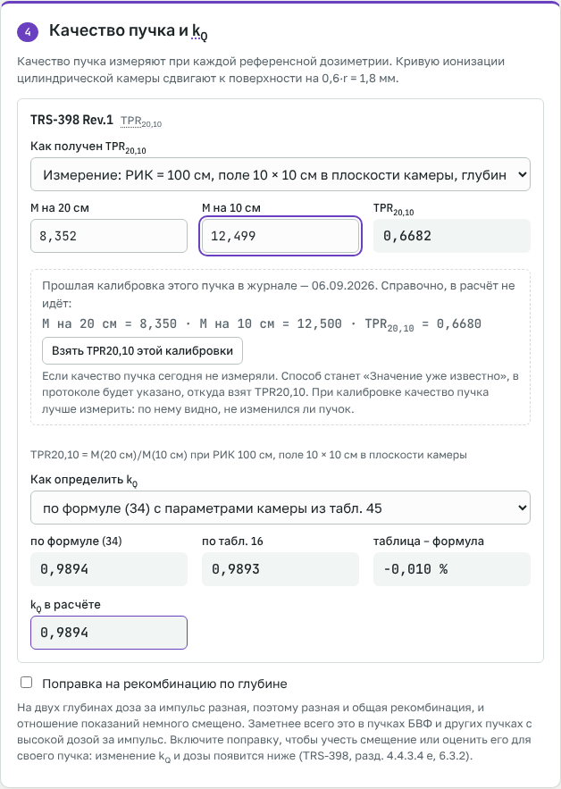
 Глубина dmax, PDD(10) или TMR(10) и номинальный выход берутся из настроек пучка; при первом измерении нового пучка их вводят один раз и сохраняют кнопкой «Сохранить настройки пучка в журнал».

**Шаг 5. Проверить результат.** Справа — поглощённая доза в воде на опорной глубине и на dmax, отклонение от номинала, проверка референсных условий TRS-398 Rev.1. Под ней — блок «Журнал» (шаг 6): при калибровке там же для сравнения kpol и ks прошлой калибровки пучка. Ниже — **замечания**: предупреждения (жёлтые) и справки (серые) с номером раздела, куда смотреть. Если выход вне допуска, раздел 9 ведёт через проверку и подстройку ускорителя.

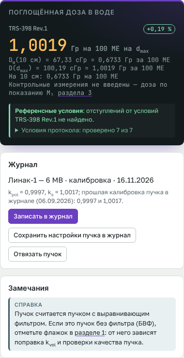

**Шаг 6. Записать в журнал.** Под результатом — блок **«Журнал»**: пучок, режим (калибровка или проверка выхода) и дата.

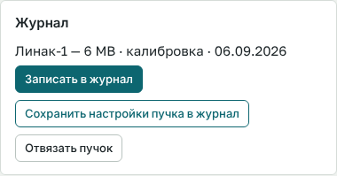

- **«Записать в журнал»** — сохраняет измерение: всю форму вкладки (по ней измерение потом открывается и пересчитывается) и итог. В строке состояния внизу появится подтверждение:

  

- **«Сохранить настройки пучка в журнал»** — запомнить настройки пучка (без показаний и условий) как значения по умолчанию.
- **«Отвязать пучок»** — вкладка снова считает сама по себе, без журнала.

Запись недоступна без даты, с датой в будущем, с ошибками в расчёте и для демонстрационного примера — в блоке сказано почему. Отклонение от номинала больше 20 % почти всегда означает ошибку ввода (МЕ, глубина номинала, камера, ND,w), поэтому такое измерение записывается только повторным нажатием «Подтвердить запись».

Пучки одного аппарата, измеренные в один день в одном режиме, собираются в **одну запись журнала** («аппарат за день»).

### 3.2. Проверка выхода

Для регулярной проверки выхода отметьте в разделе 3 флажок **«Проверка выхода: kpol и ks из предыдущей калибровки этого пучка»**. Тогда:

- вводится только одна серия — при V₁ и обычной полярности;
- kpol, ks, дата калибровки и качество пучка подставляются из **последней калибровки этого же пучка** в журнале; у каждой энергии — свои;
- если калибровка была до начала журнала, kpol, ks и дату калибровки вводят в те же поля вручную.

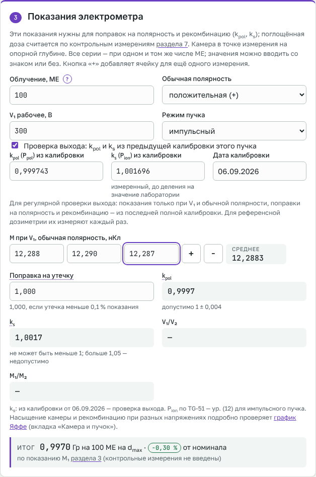

В блоке «Журнал» режим записи сменится на «проверка выхода»:

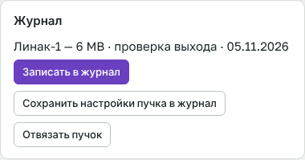

Если сменить дату, а показания остались от прошлой записи, вкладка очистит показания, T и P и скажет об этом в строке состояния: показания прошлого дня не попадут в новое измерение.

### 3.3. Электроны

Вкладка «Электроны» работает так же: пучок журнала в разделе 1, камера (для электронов по умолчанию плоскопараллельная, отмеченная в «Оборудовании» для электронов), показания трёх серий при калибровке или одной серии при проверке выхода. Качество пучка — R50 или I50; опорная глубина zref считается по нему, пересчёт на zmax — по PDD(zref), которую вводят при каждой калибровке вместе с качеством пучка. Результат и блок «Журнал» — справа.

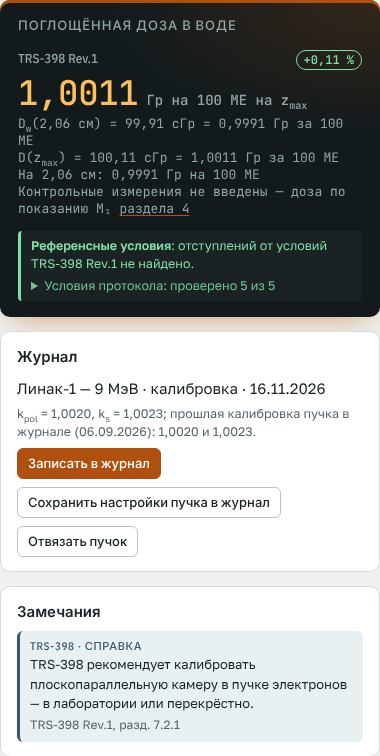

Расчёт kQ не по TRS-398 Rev.1 (Report 385, табл. 18 первого издания TRS-398) всегда помечен предупреждением и статусом «нестандартные условия».

### 3.4. ⁶⁰Co

Вкладка «⁶⁰Co» (листы «В воде» и «В пластинах»): вместо МЕ — время облучения, kQ = 1, качество пучка не измеряют. При калибровке определяют ошибку таймера τ; при проверке выхода τ, kpol и ks берутся из последней калибровки. Мощность дозы сравнивается с последней калибровкой в журнале, приведённой к дате измерения по распаду ⁶⁰Co. Подробно — [cobalt.md](cobalt.md).

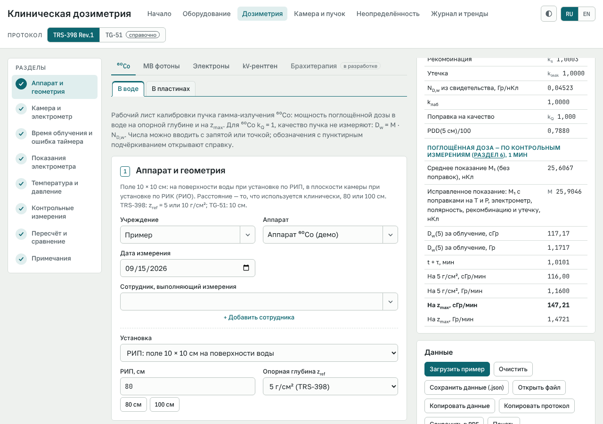

### 3.5. Сеанс: все энергии аппарата подряд

Лист **«Сеанс: все энергии»** вкладок «МВ фотоны» и «Электроны» — калибровка или проверка выхода нескольких энергий одного аппарата подряд, в воде, в референсных условиях. Своего расчёта у сеанса нет: каждая энергия измеряется на рабочем листе вкладки, как одиночная. В сеансе фотонов — только энергии фотонов, в сеансе электронов — только электронов; у ⁶⁰Co сеанса нет.

1. Откройте вкладку «МВ фотоны» (или «Электроны») и ярлык **«Сеанс: все энергии»**. Выберите аппарат, дату и режим (калибровка или проверка выхода в воде).
2. В списке отмечены все действующие энергии аппарата этого вида; рядом — дата последней калибровки. Ненужные снимите, порядок поменяйте стрелками.
3. Нажмите **«Начать сеанс»**.

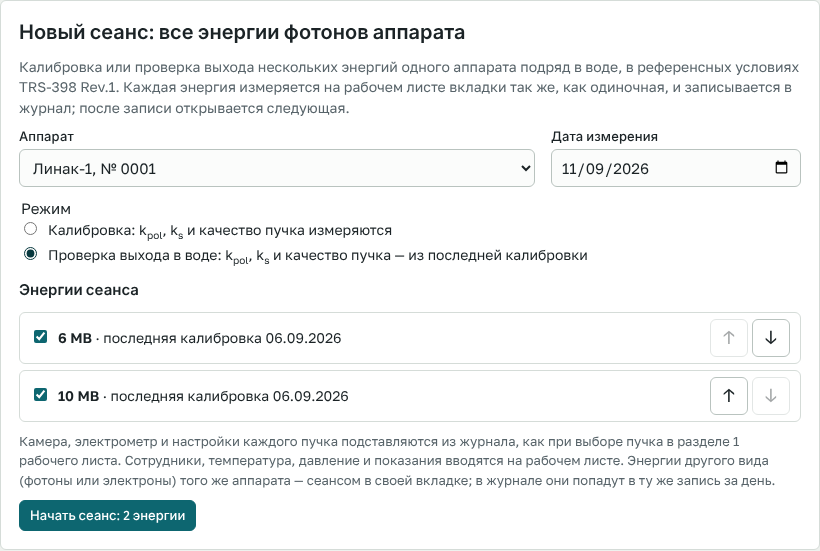

Первая энергия открывается на рабочем листе вкладки с выбранным пучком журнала, датой и режимом сеанса; ярлык «Сеанс» выделен и показывает ход («0 из 4»). Над рабочим листом — **полоса сеанса**: аппарат, дата, режим, «энергия N из M», значки энергий (записана — с отклонением от номинала, текущая, не измерена). Введите T, P и показания, затем **«Записать и далее»**: измерение записывается в журнал и открывается следующая энергия. «Пропустить» — перейти к следующей без записи, «План сеанса» — список энергий и кнопка «Завершить сеанс». Ярлык «Одна энергия» открывает тот же рабочий лист без полосы; сеанс при этом не прерывается, ярлык «Сеанс» возвращает к нему.

Все энергии сеанса попадают в одну запись журнала; если в тот же день и в том же режиме провести сеанс электронов того же аппарата, он попадёт в ту же запись. Сеанс можно прервать в любой момент: записанные энергии остаются в журнале, а сеанс, начатый заново на ту же дату, продолжится с первой невыполненной энергии.

### 3.6. В пластинах: ежедневная проверка выхода

Лист **«В пластинах»** вкладок «⁶⁰Co», «МВ фотоны» и «Электроны» — проверка выхода в пластиковом фантоме (RW3, ПММА, полистирол). Это **не референсные условия**: страница всегда помечена «Нестандартные условия», а выход считается только относительно калибровки пучка в воде (TRS-398 Rev.1, разд. 4.2.3).

1. Откройте ярлык **«В пластинах»** нужной вкладки и выберите аппарат и энергию (в списке — только пучки вида вкладки).
2. **Привязка** (раздел 2) — один раз, сразу после калибровки в воде тем же дозиметром: калибровка в воде из журнала, материал и измеренная плотность пластин, толщина над и под камерой, МЕ, T, P и показания. Кнопка **«Сохранить привязку»** сохраняет её у пучка.

   

3. **Проверка выхода** (раздел 3) — каждый раз: дата, сотрудник, МЕ, T и P в пластинах, показания. Результат — доза в воде на 1 МЕ в точке номинала и отклонение от номинала; справочно — доза в пластинах без перевода в воду. Кнопка **«Записать в журнал»**.

   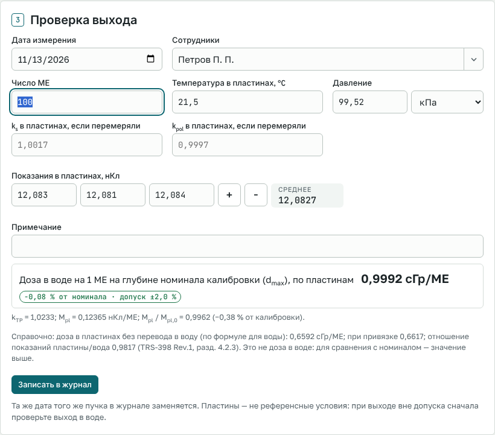

Ниже (раздел 4) — **проверки пучка в пластинах**: таблица записей с сотрудниками и контрольная карта пучка, как в «Журнале и трендах».

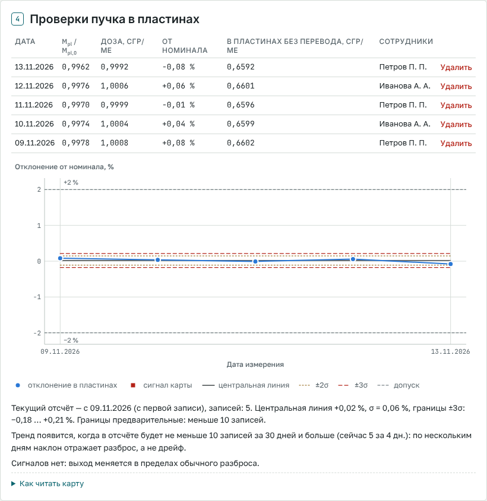

Если выход в пластинах вне допуска, сначала проверьте выход в воде и только потом подстраивайте ускоритель. Если пучок после привязки калибровали в воде заново, страница попросит повторить привязку.

### 3.7. kV-рентген

Вкладка «kV-рентген» устроена листами, как рабочая книга Excel: **«Аппарат и режимы»**, **«СПО и kQ»**, **«Ошибка таймера»**, **«Линейность»**, **«Воспроизводимость»**, **«Поглощённая доза»**, **«Сводка и протокол»**. Зелёная точка на ярлыке листа — лист заполнен. Протокол здесь всегда TRS-398 Rev.1 (справочное сравнение с DIN 6809-4 и другими протоколами — в результате справа).

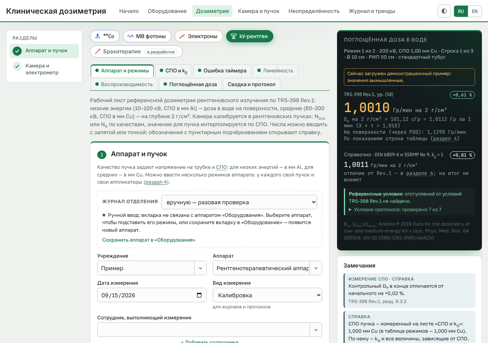

С журналом: в строке «Журнал отделения» на листе «Аппарат и режимы» выберите рентгенотерапевтический аппарат из «Оборудования» — подставятся его режимы, камеры с kV-сертификатами (действовавшими на дату измерения), электрометры и аппликаторы; во вкладке они только показываются, а меняются в «Оборудовании». Если аппарата в журнале ещё нет, заполните вкладку и нажмите **«Сохранить аппарат в «Оборудование»»**. Измерение записывается в журнал по режимам; при проверке выхода kpol, ks, τ и СПО берутся из последней калибровки режима.

Что важно знать о листах:

- **«СПО и kQ»** — СПО режимов (номинальный или измеренный по набору пластин) и kQ по kV-сертификату камеры. Если СПО в сертификате дан в другом металле, окно **«Пересчёт СПО Al ↔ Cu (DIN 6809-4)…»** пересчитывает его.
- **«Ошибка таймера»** — способ «по серии облучений с разным заданием» вводится таблицей, как в Excel: задания столбцами (в секундах или минутах), под каждым — повторные показания и среднее; τ считается по средним, на графике — только средние.
- **«Линейность»** — у заданий своя единица Q (по умолчанию Гр).
- **«Поглощённая доза»** — таблица аппликаторов режима: столбец «Аппликатор» (имя из «Оборудования») и рядом kQ; PDD(2 см) вводится в процентах или в долях (выбор над таблицей). kpol и ks измеряются сериями на режим (+V₁, −V₁, +V₂); у тонкооконных плоскопараллельных камер при напряжении до 100 кВ они равны 1 и не измеряются (TRS-398 Rev.1, разд. 4.4.3.3). Поправка на поле и РИП kg — по табл. 28 TRS-398 Rev.1; подсказка у kg показывает, как она получена для строки.

Подробно — [kv.md](kv.md).

### 3.8. Брахитерапия

Вкладка «Брахитерапия» (в разработке) проверяет силу источника HDR/PDR ¹⁹²Ir и ⁶⁰Co. Листы: **«Колодезная камера»** (IAEA TRS-492), **«Максимум отклика»**, **«Фантом PTW 9193»** (DIN 6809-2, DGMP-Bericht 13), **«Сличение камер»**, **«Стабильность»**, **«Распад»**, **«Доза TG-43»** (справочно). Сертификат источника общий для листов. Поля листов хранятся черновиком в этом браузере, записи измерений — в журнале отделения. У каждой величины и поправки — всплывающая подсказка: что обозначает, как получается и откуда берётся.

Лист устроен как остальные вкладки (с версии 0.79.0): слева — оглавление разделов, справа — итог (сила источника или доза), **«Замечания»** и **«Данные»** (очистить лист, загрузить пример). Записи брахитерапии, тренды и контрольные карты — в **«Журнале и трендах»** (см. ниже).

Порядок на листе «Колодезная камера»:

1. **Раздел 1 «Источник и его сертификат»**: выберите афтерлоадер из «Оборудования» и источник «по дате измерения» — подставятся нуклид, модель и номер источника, значение и дата сертификата. Без «Оборудования» поля заполняют вручную.
2. **Раздел 2**: выберите колодезную камеру и строку её сертификата — подставятся N, U(N), T₀, P₀ и способ ksm,sm0. Если камера калибрована в мощности поглощённой дозы в воде (ND,w, Гр·ч⁻¹·А⁻¹ или сГр·ч⁻¹·нА⁻¹; с версии 0.79.0), выберите эту единицу: лист посчитает Ḋw на 1 см (TRS-492, разд. 7.4) и для сравнения с сертификатом SK = Ḋw/Λ; модель источника для Λ выбирается здесь же.
3. **Раздел 3**: дата и время измерения, T, P, показания тока в точке максимального отклика (её находят на листе «Максимум отклика») — с версии 0.78.0 тремя сериями «Введение 1–3»: источник каждый раз заново выводится в точку максимума, в серии не меньше пяти показаний после стабилизации (TRS-492, разд. 8.2.2; программа проверяет дрейф, СКО среднего и расхождение серий); по желанию утечка, kpol и ks. Время сертификата и измерения лучше указывать: без него для ¹⁹²Ir ошибка распада — до 0,94 % за сутки.
4. **Раздел 4 «Результат»**: ОМВК на время измерения, SK, отклонение от сертификата с отметкой (до 3 % — в пределах; 3–5 % — выяснить причину; больше 5 % — источник клинически не использовать; TRS-492, разд. 8.6.2) и все поправки. **Раздел 5** — бюджет неопределённости (примеры TRS-492, табл. 10; в столбце «Своё» можно ввести свои значения) и проверка «согласие с сертификатом при k = 2»: для неё в разделе 1 укажите неопределённость сертификата и её k (пусто — типичные 5 % при k = 3).
5. **«Запись в журнал»**: кто выполнил, примечание, кнопка **«Записать в журнал»**. Запись того же дня по тому же аппарату и камере заменяет прежнюю.
6. **«Протокол измерения»** (с версии 0.77.0): **«Показать протокол»**, **«Печать протокола»**, **«Сохранить протокол в PDF»**.

Остальные листы:

- **«Максимум отклика»** — таблица «положение источника — показание» с шагом не больше 2,5 мм; кнопка «+» ставит следующее положение. Максимум — вершина параболы по точкам в ±20 мм от наибольшего показания (TRS-492, ур. 25–26; для SI IVB 1000 выберите «первый локальный максимум от входа»), плато 99,5 и 99 %, сдвиг от опорной точки сертификата; кнопка «Мерить в … мм» переносит положение на лист колодезной камеры.
- **«Фантом PTW 9193»** — камера с ND,w из «Оборудования», заряды в четырёх положениях. Варианты множителя — по DGMP 13 и руководству PTW, для ⁶⁰Co — из литературы и свой ktot сличением с колодезной камерой; основной выбирается в таблице. Раздел 5 — поглощённая доза в воде.
- **«Сличение камер»** — N рабочей колодезной камеры по эталонной на том же источнике; кнопка «Перенести на лист «Колодезная камера»».
- **«Стабильность»** — показание контрольного источника (или пучка, источника HDR, второй камеры) против исходного; допуск ±0,5 % (для второй камеры ±0,1 % от текущего среднего — его даёт кнопка по записям журнала); кнопка «Записать это значение как исходное».
- **«Распад»** — сила источника по датам и дата, когда она упадёт до заданной; таблицу можно сохранить в CSV.
- **«Доза TG-43»** — справочная мощность дозы в точках по Λ, gL и (с версии 0.79.0) F(r, θ) из таблиц HEBD для моделей из списка; точки дальше 10 см помечены «†» (взято F на 10 см). Это не замена системы планирования.

**Пример.** Кнопка **«Загрузить пример»** в панели «Данные» справа (нажать два раза) заполняет все листы вымышленным днём измерений: можно посмотреть, как выглядят результаты и протокол. Пока загружен пример, вверху вкладки об этом сказано.

**Протокол** — шапка (дата, учреждение, аппарат, источник и сертификат, средства и условия измерений, методика), результат с поправками, неопределённость, заключение, примечание и подписи из поля «Выполнил(и)». Печатается без остального листа. Протокол прежнего измерения: в «Журнале и трендах» нажмите «Открыть на листе» у записи, затем «Печать протокола».

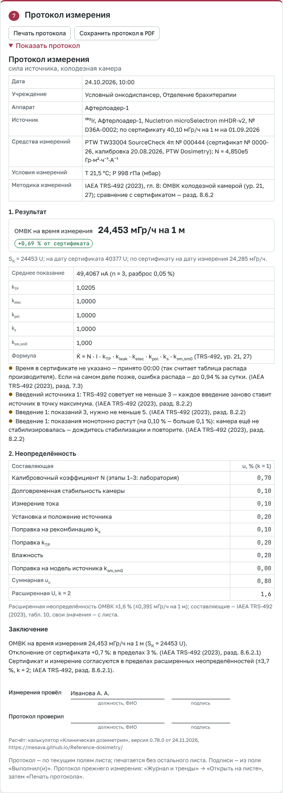

**Записи брахитерапии — в «Журнале и трендах»** (с версии 0.79.0; раньше был отдельный лист «Журнал»). В списке аппаратов — группа **«Брахитерапия»**: все записи, отдельный афтерлоадер или отдельная камера; ссылка «Журнал и тренды» есть и в разделе записи на листе. Раздел **«Записи брахитерапии»**: дата, измерение (вид, аппарат и источник или камера), результат и отклонение, кто выполнил; **«Открыть на листе»** возвращает поля записи на лист брахитерапии, **«Удалить»** — двумя нажатиями. Раздел **«Тренды и контрольные карты»**: отклонение от сертификата по аппарату (после замены источника отсчёт начинается заново) и отклонение от исходного значения камеры, с линиями допусков и сигналами 3σ, CUSUM и тренда, как у ускорителей (см. [4.2](#42-контрольная-карта)). Границы карты появляются с пяти записей.

Подробно — [brachy.md](brachy.md).

---

## 4. Журнал и тренды

Раздел **«Журнал и тренды»** показывает историю записей одного аппарата. Выберите аппарат и группу пучков (фотоны, электроны, ⁶⁰Co — только те, что есть у аппарата). Рентгенотерапевтические аппараты — в том же списке (см. конец раздела), брахитерапия — в группе «Брахитерапия» (см. [3.8](#38-брахитерапия)).

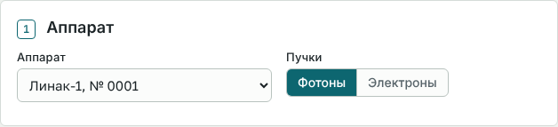

### 4.1. Выход по датам

Отклонение дозы от номинала по датам для каждого пучка: сплошные значки — калибровки, полые — проверки выхода, пунктир — допуск. При наведении курсора видны значения всех пучков на ближайшую дату; под графиком — «Таблица значений».

### 4.2. Контрольная карта

Выход одного пучка относительно его обычного уровня: центральная линия (среднее первых 20 записей отсчёта) и границы ±2σ и ±3σ, где σ — обычный разброс от записи к записи. Карта замечает сдвиг или дрейф раньше, чем выход уйдёт за допуск.

- **Сигналы** (красные квадраты) — точка за 3σ или накопленная сумма (CUSUM) для небольшого устойчивого сдвига. Под картой — список сигналов с датами.
- **Наблюдения** — не сигнал, а повод посмотреть следующие записи («2 из 3 точек за 2σ», «8 точек подряд по одну сторону» и т. п.).
- **Тренд** — наклон в %/мес и его значимость; считается, когда в отсчёте не меньше 10 записей за 30 дней.
- **Отсчёт начинается заново** после подстройки ускорителя, смены камеры, электрометра, ND,w или kelec, геометрии калибровки и по кнопке «Новый отсчёт карты» у записи (например, после ремонта).
- «Как читать карту» внизу раздела — краткая справка.

### 4.3. Общая часть записей

Отклонение каждого пучка от его обычного уровня делится на **общую для записи часть** (медиана по пучкам) и собственную часть пучка. Если сдвинулись все пучки вместе — причина скорее общая: дозиметр, термометр, барометр, ND,w или мониторная камера ускорителя. Если ушёл один пучок — причина в нём. На примере ниже 09.10.2026 все пучки сдвинулись на +2 % вместе — на карте общей части это сигнал, а собственные части пучков в тот день в пределах обычного разброса.

### 4.4. kpol, ks и τ по калибровкам

Таблица поправок, измеренных при калибровках (у ⁶⁰Co — и ошибка таймера τ). Их изменение от калибровки к калибровке — ранний признак неполадки камеры, кабеля, электрометра или привода источника.

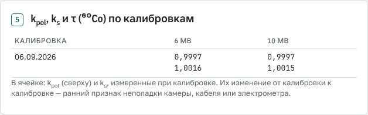

### 4.5. Записи журнала и протокол

Список записей аппарата (новые сверху): дата, режим, число пучков, сотрудники, значение и отклонение каждого пучка. Кнопки:

- **«Открыть во вкладке»** — пучок записи открывается на своей вкладке дозиметрии по записанной форме, со всеми поправками и замечаниями; изменения там в журнал не попадают, кнопка над рабочим листом возвращает прежние данные вкладки;
- **«Протокол»** — протокол записи (аппарат за день);
- **«Новый отсчёт карты»** — начать контрольную карту заново с этой записи;
- **«Перенести на другую дату»** — если запись внесли не с той датой: под кнопками появляется поле «Новая дата записи» и кнопка «Перенести». Переносится вся запись (все пучки аппарата за этот день), доза не меняется; у ⁶⁰Co ожидаемая мощность пересчитывается по распаду. Перенос не выполняется на дату в будущем, на дату, где у аппарата уже есть запись в том же режиме, и если проверка выхода оказалась бы раньше своей калибровки (или калибровка — позже опирающихся на неё проверок и привязки пластин). Записи рентгенотерапевтических аппаратов не переносятся;
- **«Удалить»** — срабатывает по повторному нажатию;
- **«Выгрузить журнал в CSV»** (под списком) — все записи всех аппаратов для Excel: по строке на пучок.

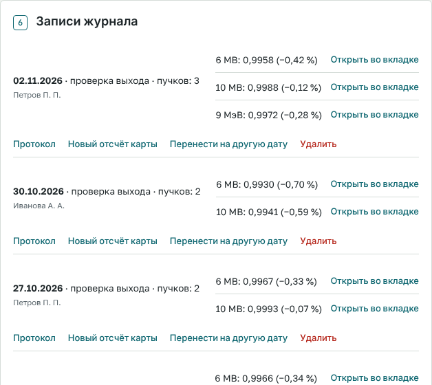

Протокол записи — учреждение, аппарат, дата, режим, протокол, сотрудники, условия; по каждому пучку — камера со свидетельством о калибровке, электрометр, доза, отклонение и допуск, поправки, kQ, качество пучка; строки для подписи. Его можно скопировать текстом или сохранить в PDF. Подробный протокол одного пучка со всеми таблицами — PDF вкладки дозиметрии.

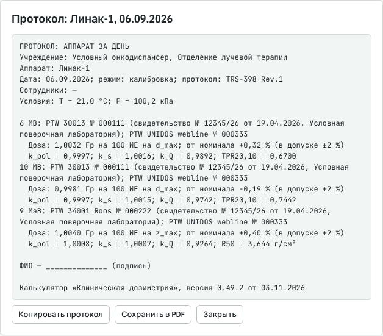

### 4.6. Контроль дозиметра и проверки в пластинах

- **Контроль дозиметра** (раздел 7) — карта отношения доз рабочей и второй камеры, если при измерениях делали проверку дозиметра второй камерой (раздел в конце вкладок дозиметрии). Без таких проверок раздел показывает одну строку-пояснение.
- **Проверки в пластинах** (раздел 8) — таблица проверок выхода в пластинах (отношение к привязке, отклонение от номинала, доза в пластинах без перевода, к какой калибровке привязано) со ссылкой на лист «В пластинах» вкладки пучка, где у каждого пучка своя контрольная карта.

Для рентгенотерапевтического аппарата разделы другие: выход по режимам, контрольная карта режима, общая часть режимов, сводная по датам («режим × аппликатор», с копией для Excel), режим по датам и записи журнала — см. [kv.md](kv.md#журнал-и-тренды-для-kv-с-0480).

---

## 5. Частые вопросы

**Где хранятся данные?** Журнал — в файле `.json`, который вы открыли или сохранили; в браузере — только его рабочая копия. Черновики вкладок, списки учреждений и сотрудников хранятся в этом браузере: на другом компьютере их не будет. Чтобы перенести отдельное измерение, сохраните его кнопкой «Сохранить данные (.json)» и откройте на другом устройстве.

**Какие файлы сохраняет программа и как их различить?** Имя файла начинается с того, что в нём лежит (с версии 0.67.0); дальше — учреждение или аппарат и дата. Журнал один: в нём вместе хранятся оборудование, записи калибровок и проверок, тренды и контрольные карты.

| Начало имени | Что это | Пример |
|---|---|---|
| `журнал_` | сам журнал: оборудование, записи, тренды | `журнал_ЛОР.json` |
| `копия-журнала_` | автоматическая копия журнала из папки копий | `копия-журнала_ЛОР_2026-11-12_101500.json` |
| `таблица-записей_`, `таблица-проверок-дозиметра_`, `таблица-kV_` | выгрузка из журнала для Excel | `таблица-записей_ЛОР_2026-11-12.csv` |
| `расчёт-фотоны_`, `расчёт-электроны_`, `расчёт-Co-60_`, `расчёт-kV_`, `расчёт-Яффе_` и др. | отдельное измерение, сохранённое кнопкой «Сохранить данные (.json)» во вкладке | `расчёт-фотоны_Halcyon_6X_2026-11-12.json` |
| `Дозиметрия_`, `Протокол_` | протокол в PDF | `Дозиметрия_Halcyon_6X_2026-11-12.pdf` |

Имя самого журнала программа не меняет: если файл уже сохранён под своим именем, он так и называется.

**Как вести журнал с нескольких компьютеров (например, рабочий компьютер и ноутбук в пультовой)?** Журнал — один файл `.json`, и все компьютеры должны работать с **этим же файлом**, а не с его копиями.

1. Положите файл журнала в папку, доступную с обоих компьютеров: общую (расшаренную) папку или сетевой диск отделения, если компьютеры в одной сети, или папку, которая синхронизируется облачным диском, если нет.
2. На каждом компьютере откройте сайт в Chrome или Edge, нажмите **«Открыть журнал»** и выберите этот файл. Это делается один раз: дальше изменения записываются в файл сами, а после перезагрузки страницы достаточно нажать «Продолжить с файлом…».
3. Пока страница открыта, журнал каждые 15 секунд и при возврате на вкладку сверяется с файлом (с версии 0.55.0). Если журнал изменили на другом компьютере, а здесь своих изменений нет, свежая версия подгружается сама: в строке над кнопками будет «обновлён из файла (изменения другого компьютера)». Если изменения есть и там, и тут, они сливаются по записям: например, калибровка, внесённая на рабочем компьютере, и проверка выхода, внесённая в пультовой, остаются обе. Выбрать версию («Взять версию из файла» или «Записать мою поверх») программа попросит, только если одно и то же поле одной записи или карточки изменили на обоих компьютерах, и напишет, что разошлось. Одну и ту же работу одновременно на двух компьютерах лучше не вести.

**Папка копий — не сам журнал.** В неё при сохранении кладутся датированные копии (`копия-журнала_ЛОР_2026-11-12_101500.json`; до версии 0.67.0 копии назывались как сам журнал — `журнал_ЛОР_2026-11-12_101500.json`) на случай ошибки или порчи файла. Если журнал и копии лежат в одной общей папке, на другом компьютере открывайте файл журнала (`журнал_ЛОР.json`), а не копию с датой: иначе вы продолжите старую копию и записи двух компьютеров разойдутся. Копию открывают, только чтобы вернуться к прежнему состоянию.

В Firefox и Safari журнал нельзя связать с файлом: после работы сохраните журнал (он скачается), замените им файл в общей папке, а на другом компьютере откройте этот файл. Черновики вкладок, списки сотрудников и «Мои камеры» хранятся в каждом браузере свои и вместе с журналом не переносятся.

**Пучка нет в списке вкладки.** Проверьте в «Оборудовании», что пучок нужного вида (фотоны, электроны, ⁶⁰Co) и у него стоит отметка «используется в измерениях».

**Проверка выхода не считается: нет kpol и ks.** Для проверки выхода нужны kpol и ks из калибровки. Без них — ошибка, и измерение не записывается. Запишите калибровку пучка в журнал или введите kpol, ks и дату прежней калибровки вручную в разделе 3.

**Как внести старые протоколы, чтобы построился тренд?** Дата записи в журнале — это поле **«Дата измерения»** в разделе 1 вкладки (см. снимок в [3.1](#31-калибровка-пучка-мв-фотонов); на вкладке kV — на листе «Аппарат и режимы»). По умолчанию там стоит сегодняшняя дата, её можно заменить на дату протокола (дату в будущем журнал не принимает).

1. Выберите аппарат и пучок журнала, поставьте дату первого протокола и только потом введите показания, условия и МЕ. Нажмите «Записать в журнал».
2. Смените дату на дату следующего протокола и введите его показания. Если показания прежнего протокола остались во вкладке, при смене даты они очищаются, и в строке состояния об этом сказано: старые данные не попадут в новую дату.
3. Вносите протоколы от старых к новым: для проверки выхода kpol, ks и качество пучка берутся из последней калибровки до её даты, поэтому калибровку вносят раньше опирающихся на неё проверок. Если камеру с тех пор перекалибровали и новое свидетельство внесено через «Новый сертификат…», для старой даты подставится свидетельство из истории.

Измерение с другой датой — новая запись, прежние не меняются. Тот же пучок за ту же дату в том же режиме (калибровка или проверка выхода) и по тому же протоколу заменяет прежнюю запись: тогда в блоке «Журнал» об этом сказано и кнопка называется «Заменить запись в журнале».

Записи разных дат ложатся на график «Выход по датам» в «Журнале и трендах» (см. [4.1](#41-выход-по-датам)).

**Запись внесли не с той датой.** «Журнал и тренды» → «Записи журнала» → **«Перенести на другую дату»** у этой записи: введите верную дату и нажмите «Перенести» (см. [4.5](#45-записи-журнала-и-протокол)).

**Как посмотреть старое измерение?** «Журнал и тренды» → «Записи журнала» → «Открыть во вкладке» у нужного пучка. Измерение откроется по записанной форме и покажет ту же дозу, даже если камеру потом перекалибровали.

**Как исправить ошибочную запись?** Откройте её во вкладке, проверьте ввод, исправьте и запишите заново на ту же дату: повторная запись того же пучка за ту же дату заменяет прежнюю (кнопка «Заменить запись в журнале») или удалите ошибочную запись в списке записей. Если неверна только дата — перенесите запись (см. выше).

**Камеру перекалибровали — что будет со старыми записями?** Ничего: каждая запись хранит свидетельство и коэффициенты, по которым посчитана. Новое свидетельство вносят в «Оборудовании» кнопкой «Новый сертификат…» (см. [2.5](#25-камеры)); на контрольной карте с новым ND,w начнётся новый отсчёт.

**Калькулятор заменяет протокол отделения?** Нет. Результат нужно проверить по процедуре отделения; ответственность за клиническую калибровку несёт медицинский физик.
